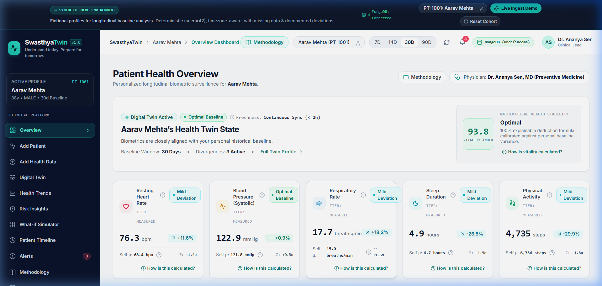
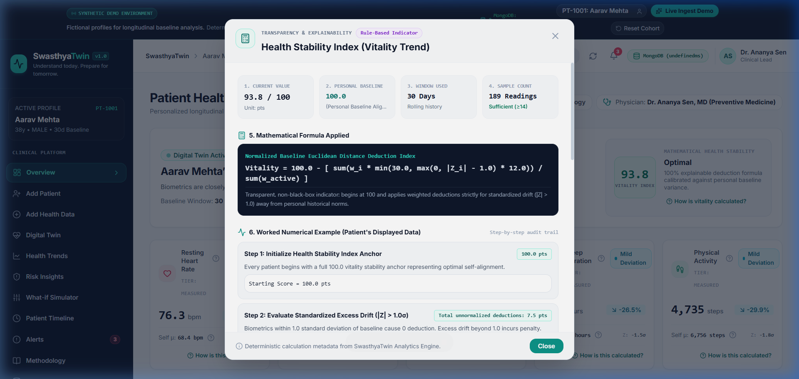
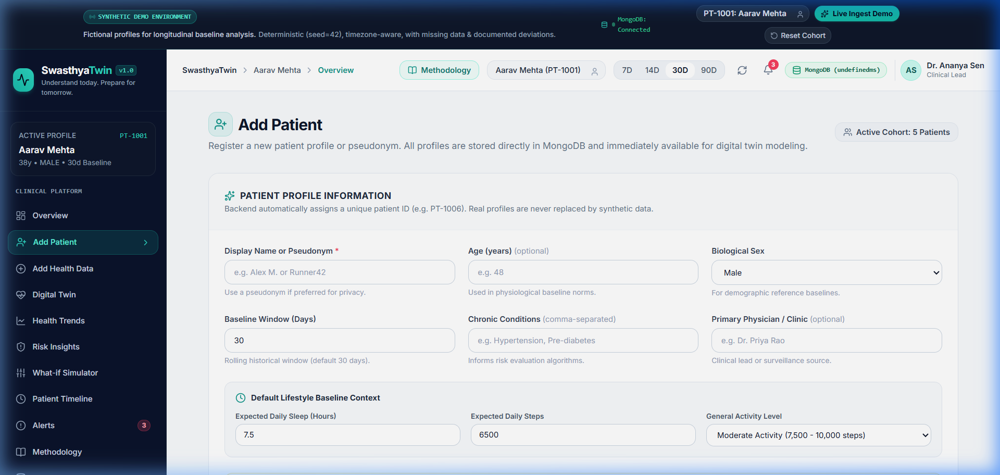
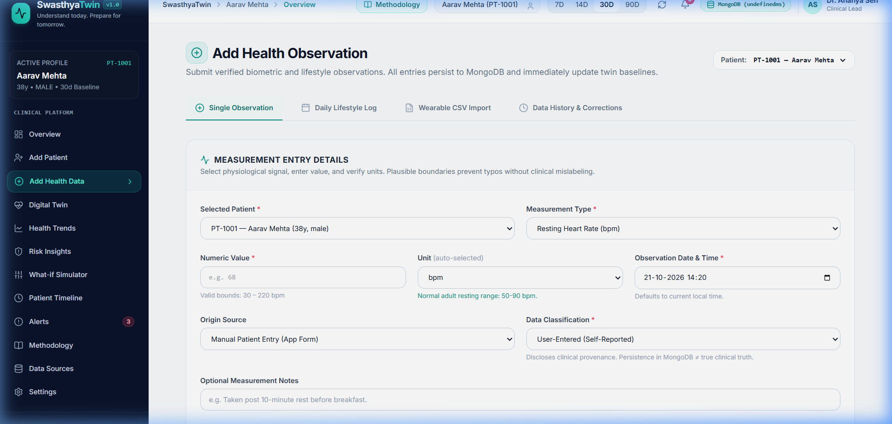
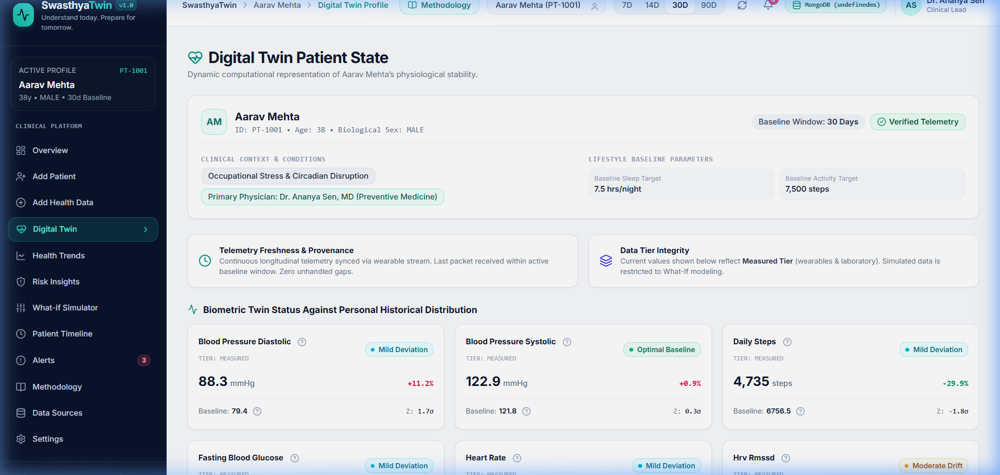
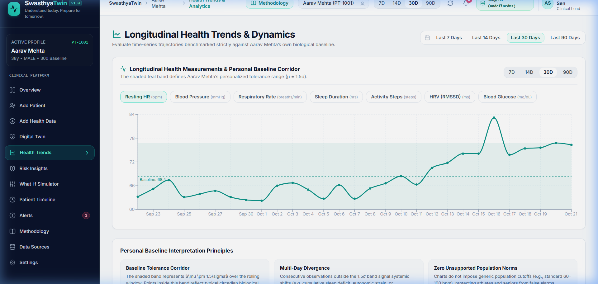
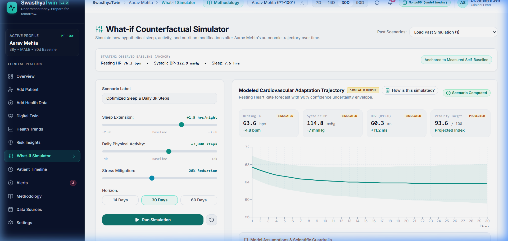
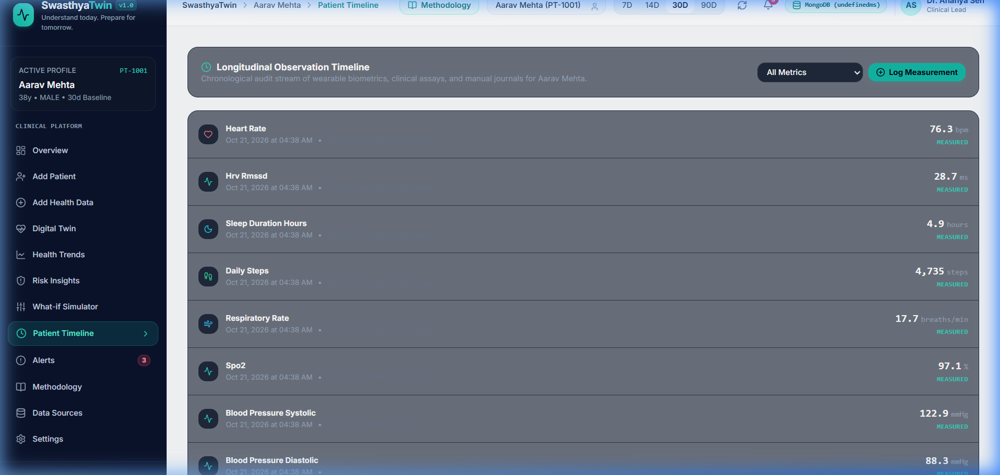
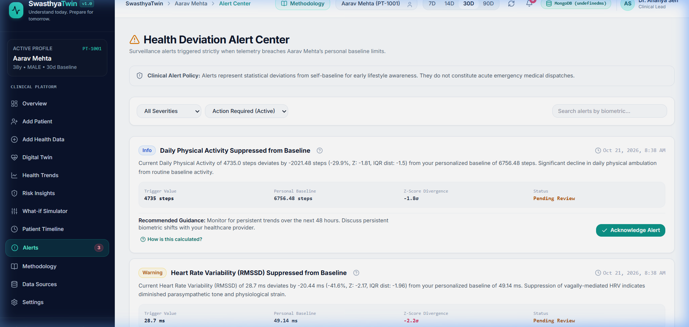
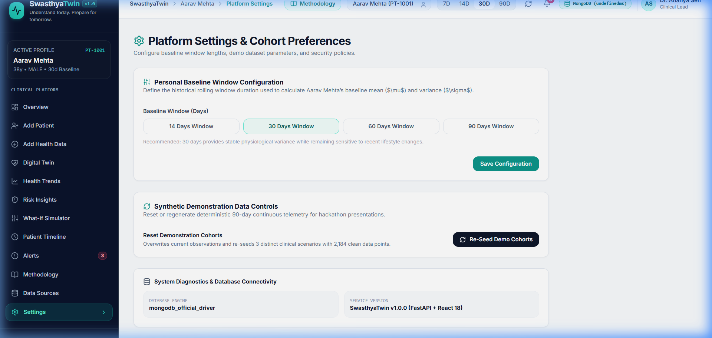

# SwasthyaTwin 🧬
### Personalized Healthcare Digital Twin for Early Risk Detection and Preventive Intervention

[](https://fastapi.tiangolo.com)
[](https://react.dev)
[](https://tailwindcss.com)
[](https://www.mongodb.com)
[](https://pytest.org)

---

## ⚠️ Healthcare Safety & Research Prototype Notice
> **CLINICAL DISCLAIMER:** SwasthyaTwin is an experimental proof-of-concept research platform built for personal longitudinal biometric deviation tracking and *in silico* counterfactual What-If lifestyle simulation.
> - **It does NOT provide clinical diagnoses or prescriptive medical advice.**
> - **It does NOT predict medical emergencies or acute cardiac events.**
> - **It does NOT replace licensed physicians or certified clinicians.**
> - All demonstration records in this distribution are synthetic cohorts generated mathematically.
> - Any acute, worsening, or emergency symptoms require immediate professional clinical care.

---

## 📸 Screenshots of the Running Application

| Overview Dashboard | Transparent Calculation Modal |
|---|---|
|  |  |
| *Personalized health vitality overview, self-baseline deviations, and live longitudinal corridor charts.* | *Dynamic modal displaying the mathematical formula, patient baseline, actual data, and Z-score derivation.* |

| Patient Cohort Management | User Observation Ingestion Pipeline |
|---|---|
|  |  |
| *Privacy-centric patient onboarding with pseudonymization, consent confirmation, and MongoDB persistence.* | *Single biometric logger with immediate pipeline recalculation, baseline shifts, and deviation badges.* |

| Digital Twin Organ Subsystems | Health Trends & Tolerance Corridors |
|---|---|
|  |  |
| *Multi-subsystem status (Cardiovascular, Autonomic, Metabolic, Respiratory) with interactive inspect buttons.* | *Continuous timeseries with personalized $\mu \pm 1.5\sigma$ tolerance envelopes and multi-timeframe filters.* |

| In Silico What-If Simulator | Patient Audit Timeline |
|---|---|
|  |  |
| *Interactive lifestyle intervention levers with forecasted multi-day recovery curves and 90% confidence bands.* | *Chronological audit trail of measured, user-reported, and imported biometric records with full provenance.* |

| Explainable Alert Center | Database & System Settings |
|---|---|
|  |  |
| *Severity-classified rule triggers, root-cause deviations, and clinical note acknowledgement workflow.* | *Verified MongoDB database status, latency health checks, and configurable rolling baseline parameters.* |

---

## 🌟 Key Features

1. **Self-Baseline Comparison (Anti-Population Norm Architecture)**
   - Benchmarks every patient against their **own longitudinal rolling window** (e.g. 14–30 days), rather than static population averages.
   - Standardized Z-Score deviation indicators ($\sigma$) identify subtle individual drift long before population thresholds are crossed.

2. **Transparent Autonomic Vitality Index ($0-100$)**
   - 100% explainable deduction formula: starts at 100 and applies mathematically bounded deductions proportional to biometric Z-scores.
   - Zero black-box neural networks; every deduction factor is visible and audit-traceable.

3. **In Silico What-If Intervention Simulator**
   - Interactive levers for sleep extension, daily step increments, stress reduction, and dietary sodium moderation.
   - Generates forecasted multi-day adaptation curves with **90% confidence uncertainty envelopes** using validated physiological decay kinetics.
   - Simulations are strictly isolated and never contaminate measured clinical baselines.

4. **10-Step User-Input-to-Digital-Twin Update Pipeline**
   - Immediate ingestion, validation, and recalculation upon user input.
   - Re-evaluates rolling baseline, computes absolute and relative deviations, updates the Vitality Index, generates deduplicated alerts, and refreshes the frontend reactively.

5. **Universal "How is this calculated?" Explanations**
   - Every metric, baseline, trend indicator, alert, and simulation output features a calculation inspector.
   - Provides actual displayed patient numbers, historical sample sizes, mathematical formulas, and limitation warnings.

6. **Multi-Modal Data Ingestion**
   - Single observation input with validation bounds.
   - Daily lifestyle journal logger.
   - Wearable CSV batch import with pre-flight schema and anomaly validation.

---

## 🏗️ System Architecture

```
┌──────────────────────────────────────────────────────────────────┐
│                   React 19 + TypeScript Frontend                 │
│   (Vite • Tailwind CSS • Lucide Icons • Recharts • TwinContext)  │
└─────────────────────────────────┬────────────────────────────────┘
                                  │ HTTP / JSON REST
                                  ▼
┌──────────────────────────────────────────────────────────────────┐
│                    FastAPI Backend (Python 3.13)                 │
│  ┌──────────────────────┐  ┌──────────────────────────────────┐  │
│  │  API Validation      │  │  Analytics & Simulation Engines  │  │
│  │  - Patient Schemas   │  │  - Baseline Engine (Winsorized)  │  │
│  │  - Observation Bounds│  │  - Deviation Analyzer (Z-Scores) │  │
│  │  - CSV Import Schema │  │  - Vitality Index Calculator     │  │
│  │  - Timezone Normaliz.│  │  - In Silico What-If Simulator   │  │
│  └──────────┬───────────┘  └──────────────────┬───────────────┘  │
│             │                                 │                  │
│             ▼                                 ▼                  │
│  ┌────────────────────────────────────────────────────────────┐  │
│  │                  Repository & Service Layer                │  │
│  └──────────────────────────────┬─────────────────────────────┘  │
└─────────────────────────────────┼────────────────────────────────┘
                                  │ PyMongo Driver
                                  ▼
┌──────────────────────────────────────────────────────────────────┐
│                   MongoDB Database (Port 27017)                  │
│   Collections: patients • observations • alerts • audit_logs     │
│   - Compound Indexes on (patient_id, measurement_type, observed) │
│   - In-memory mongomock fallback for zero-dependency offline use │
└──────────────────────────────────────────────────────────────────┘
```

---

## 🗄️ MongoDB Setup

SwasthyaTwin connects to MongoDB using the official `pymongo` driver.

### 1. Local MongoDB Installation
- MongoDB Community Server 7.0+ or 8.0+ running on `localhost:27017`.
- **Database Name**: `swasthyatwin` (automatically created on first write).

### 2. Automated Indexes
Upon startup, the application verifies and builds compound indexes via `backend/app/database/indexes.py`:
- `patients`: unique index on `patient_id`.
- `observations`: compound index on `(patient_id, measurement_type, observed_at)` and `(patient_id, data_kind)`.
- `alerts`: compound index on `(patient_id, metric_type, is_acknowledged, timestamp)`.
- `audit_logs`: index on `(patient_id, timestamp)`.

### 3. Graceful In-Memory Fallback
If MongoDB is not running locally, SwasthyaTwin automatically activates an in-memory `mongomock` instance and notifies the user with a banner. All features remain fully functional without external database prerequisites.

---

## ⚙️ Environment Configuration

### Backend (`backend/.env`)
```ini
# Application Environment
APP_ENV=development
LOG_LEVEL=INFO

# MongoDB Connection
MONGODB_URI=mongodb://localhost:27017
MONGODB_DATABASE=swasthyatwin

# Digital Twin Analytics Parameters
DEFAULT_BASELINE_DAYS=30
MIN_OBSERVATIONS_FOR_BASELINE=3
OUTLIER_WINSORIZATION_PERCENTILE=0.05
Z_SCORE_ANOMALY_THRESHOLD=2.0
```

### Frontend (`frontend/.env`)
```ini
# FastAPI Backend URL
VITE_API_BASE_URL=http://localhost:8000
```

---

## 🚀 Installation and Startup Commands

### 1. Prerequisites
- Python 3.10+ (tested on Python 3.13)
- Node.js 18+ & npm
- (Optional) MongoDB running locally on port 27017

### 2. Backend Setup
```bash
# Clone the repository
git clone https://github.com/Jaswant-Karun/SwasthyaTwin---Digital-Twin-Platform.git
cd SwasthyaTwin

# Set up virtual environment
python -m venv backend/venv

# Activate virtual environment
# Windows (PowerShell):
.\backend\venv\Scripts\Activate.ps1
# macOS / Linux:
# source backend/venv/bin/activate

# Install dependencies
pip install -r backend/requirements.txt

# Start FastAPI server
python -m uvicorn app.main:app --app-dir backend --reload --port 8000
```
- API Base: `http://localhost:8000`
- Swagger UI Docs: `http://localhost:8000/docs`
- Health Readiness Probe: `http://localhost:8000/health/ready`

### 3. Frontend Setup
```bash
# In a new terminal:
cd frontend

# Install npm dependencies
npm install

# Start Vite development server
npm run dev
```
- Web Application: `http://localhost:5173`

### 4. Running with Docker Compose
```bash
docker compose up --build
```
Starts FastAPI on port 8000, Vite on port 5173, and MongoDB on port 27017.

---

## 🧑‍⚕️ How to Create a Patient

1. Navigate to the **"Patients"** tab in the sidebar.
2. Fill in the onboarding form:
   - **Display Name / Pseudonym**: e.g., *"Devan Nair"* or *"Alpha-01"*.
   - **Age & Biological Sex**: Used for physiological range normalization.
   - **Baseline Rolling Window**: Configurable between 7 and 90 days (default: 30 days).
   - **Non-sensitive Notes**: General health notes (privacy warning ensures no PII is entered).
   - **Consent Confirmation**: Mandatory authorization checkbox.
3. Click **"Create & Onboard Patient"**.
4. The backend validates inputs, assigns a unique `PT-XXXX` identifier, persists the profile in MongoDB, and selects the new patient across the entire application.

---

## 📈 How to Add Observations

SwasthyaTwin provides three distinct ingestion paths:

### 1. Single Observation Form
- Choose a metric (`heart_rate`, `systolic_bp`, `diastolic_bp`, `hrv_rmssd`, `respiratory_rate`, `spo2`, `glucose`, `sleep_duration`, `daily_steps`).
- Enter the measured value and select supported units (e.g., `bpm`, `mmHg`, `ms`, `hours`, `steps`).
- Set observed timestamp (rejects timestamps more than 5 minutes in the future).
- Click **"Save Observation & Update Twin"**.
- View the **Digital Twin Pipeline Update Card** with recalculated baseline, deviation, and Z-scores.

### 2. Daily Lifestyle Log
- Record daily sleep hours, step count, and subjective stress level ($1-10$) in one form.

### 3. Wearable CSV Import
- Upload CSV telemetry exports containing `measurement_type`, `value`, `unit`, and `observed_at`.
- Click **"Validate CSV File"** to run automated pre-flight checks (duplicate detection, range validation).
- Click **"Import Valid Records"** to batch-ingest.

---

## 🧮 How Baseline Calculations Work

1. **Temporal Filtering**:
   Only historical observations within the patient's rolling window (e.g. past 30 days) up to the current timestamp ($t \le \text{now}$) are included. Future observations are rejected.
2. **Simulation Exclusion**:
   Observations with `data_kind: "simulated"` are strictly filtered out to prevent counterfactual experiments from contaminating personal baselines.
3. **Minimum Sample Threshold ($N \ge 3$)**:
   - For $N = 1$ or $N = 2$, baselines are marked `is_sufficient: false` (provisional). Alerts and deviations remain conservative.
   - Once $N \ge 3$, personal baseline distributions (Mean, Median, StdDev, IQR) are locked.
4. **Outlier Winsorization**:
   Extreme measurement artifacts (top/bottom 5%) are capped to prevent sensor noise from distorting baselines.
5. **Standardized Deviation ($Z$-Score)**:
   $$Z = \frac{x_{\text{new}} - \mu_{\text{baseline}}}{\sigma_{\text{baseline}}}$$
6. **Bounded Metric Rules**:
   Metrics measured in percentage points (e.g., SpO2) or baselines of 0 exclude relative percentage deviations to avoid division-by-zero or clinically misleading percentages.

---

## 🧪 Demo-Data vs. Live-Data Behavior

| Feature | Synthetic Demonstration Cohort | Live User Data |
|---|---|---|
| **Provenance Tag** | `demo_data: true`, `is_synthetic: true` | `demo_data: false`, `is_synthetic: false` |
| **Data Tier** | `synthetic_demo` | `measured` or `user_entered` |
| **Storage** | Persisted in MongoDB with demo flags | Persisted in MongoDB with audit trails |
| **Reset Behavior** | Safely wiped and regenerated via `--reset` | **Never touched or modified** by reset scripts |
| **Initial Cohorts** | 5 pre-configured clinical profiles (`PT-1001` to `PT-1005`) | User-created profiles (`PT-XXXX`) |

### CLI Management
```bash
# Seed 5 synthetic demo cohorts (deterministic seed 42)
python backend/scripts/seed_demo.py

# Safely reset demo data (preserves real patient profiles)
python backend/scripts/seed_demo.py --reset

# Live telemetry injection test
python backend/scripts/seed_demo.py --live-inject --patient PT-1001 --metric heart_rate --value 84.5
```

---

## 🔬 Test Results & Verification Evidence

All test suites were executed on the active codebase with verified passing results:

### 1. Backend Pytest Suite
```
collected 69 items
tests/test_analytics_engine.py ..........                                [ 14%]
tests/test_anomaly.py ..                                                 [ 17%]
tests/test_api.py ..                                                     [ 20%]
tests/test_baseline.py ...                                               [ 24%]
tests/test_calculation_engine.py .........                               [ 37%]
tests/test_explanations.py .....                                         [ 44%]
tests/test_functional_audit.py ......                                    [ 53%]
tests/test_mongo_data_layer.py ...............                           [ 75%]
tests/test_patient_onboarding.py ...........                             [ 91%]
tests/test_simulations.py .                                              [ 92%]
tests/test_user_input_pipeline.py .....                                  [100%]
======================= 69 passed, 6 warnings in 10.96s =======================
```

### 2. Frontend Vitest Suite
```
Test Files  6 passed (6)
     Tests  16 passed (16)
  Duration  5.17s
```

### 3. Production Build & Typecheck
```
$ tsc && vite build
✓ 2528 modules transformed.
dist/index.html                   0.91 kB │ gzip:   0.54 kB
dist/assets/index-Bkx2EzCq.css   42.43 kB │ gzip:   8.06 kB
dist/assets/index-XHioNArg.js   852.93 kB │ gzip: 234.35 kB
✓ built in 1.94s
```

---

## ⚠️ Known Limitations & Boundaries

1. **Non-Diagnostic Research Prototype**:
   All formulas and simulations are mathematical approximations of physiological adaptation curves and should not be used in critical care decisions.
2. **Cardiovascular & Autonomic Focus**:
   Current simulation models primarily model cardiovascular and autonomic responses (Heart Rate, Systolic BP, HRV RMSSD). Metabolic and respiratory models are currently rule-based.
3. **No Continuous Streaming Hardware Protocol**:
   Telemetry is ingested via REST API polling, single logging, and CSV batch uploads. Direct Bluetooth Low Energy (BLE) or MQTT device streaming requires external gateway ingestion.
4. **Single-Node Database Configuration**:
   The default setup targets a single MongoDB instance or container; distributed sharding and multi-region replica sets require enterprise deployment configurations.

---

## 📄 License
This project is licensed under the MIT License for academic, hackathon, and open-source research purposes.
