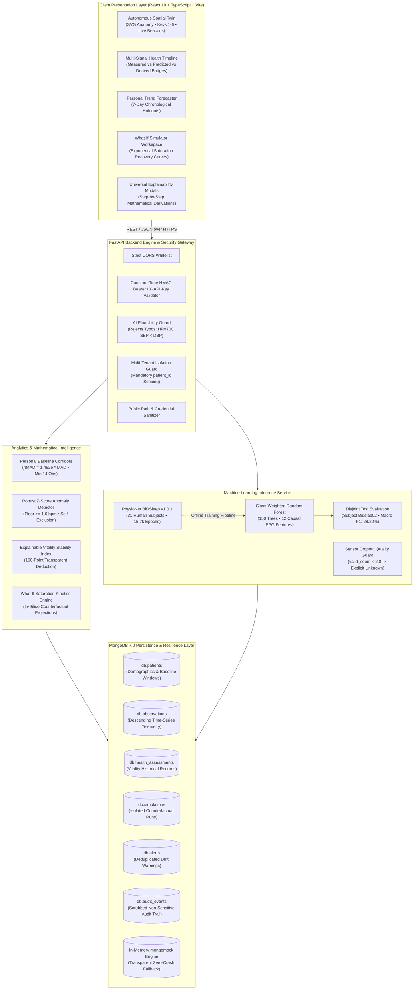

# SwasthyaTwin AI — Personalized Multisignal Health Intelligence & Digital Twin

### Happiest Health Digital Twin Challenge 2026 — Team Name: 24cb012

[](https://pytest.org)
[](https://vitest.dev)
[-10b981.svg?style=flat)](docs/final-test-report.md)
[-06b6d4.svg?style=flat&logo=vite)](https://vitejs.dev)
[](https://fastapi.tiangolo.com)
[](https://react.dev)
[](https://www.mongodb.com)
[-8A2BE2.svg?style=flat)](https://www.physionet.org/content/bidsleep-dataset/1.0.1/)

---

## ⚠️ Healthcare Safety & Research Prototype Notice

> [!WARNING]
> **CLINICAL & REGULATORY DISCLAIMER:** SwasthyaTwin AI is an experimental proof-of-concept research prototype developed for personal longitudinal biometric deviation tracking, physiological sleep-stage inference, and *in silico* counterfactual What-If lifestyle simulation.
>
> - **It is NOT an FDA, EMA, or CDSCO-cleared medical device.**
> - **It does NOT provide clinical diagnoses, triage acute medical conditions, or prescribe medical treatments.**
> - **It does NOT replace consultation with certified healthcare professionals.**
> - All demonstration patient profiles (`PT-1001` through `PT-1005`) are synthetic archetypes generated mathematically.
> - Any acute, worsening, or emergency symptoms require immediate professional clinical care.

---

## 👥 Team Details

- **Team Name:** `24cb012`

### Team Leader

- **Gangeswara S** — Team Leader

### Team Members

- **Bharanika D**
- **Jaswant karun S A**
- **Baviya Varshini V**

---

## 🏛️ College / Incubator Information

- **College / Institution Name:** KPR Institute of Engineering and Technology
- **Department & Course:** B.Tech Computer Science and Business Systems
- **City & State:** Coimbatore, Tamil Nadu

---

## 🎯 Problem Statement

Modern healthcare analytics and wearable health apps suffer from four systemic flaws:

1. **The Flaw of Generic Population Averages:** Commercial fitness trackers benchmark individuals against broad statistical averages (e.g., standard 60–100 bpm resting heart rate). An endurance athlete whose normal baseline is 46 bpm drifting to 62 bpm is experiencing significant autonomic exhaustion or acute illness, yet legacy platforms label it "Normal". Conversely, healthy variations in seniors or shift workers trigger frequent false alarms.
2. **Fragmented Longitudinal Visibility:** Observations from smartwatches, blood pressure cuffs, glucometers, and subjective sleep logs are isolated across separate vendor silos with limited visibility into longitudinal physiological changes over time.
3. **The Black-Box Dilemma:** Proprietary commercial "readiness" and "sleep quality" scores produce opaque, single-number metrics without mathematical derivations or audit trails. Clinicians and users cannot audit, trust, or act upon them.
4. **Lack of In-Silico Behavioral Exploration:** Patients receive generic advice (e.g., "sleep more") without the ability to simulate how specific behavioral changes (e.g., +1.5 hours sleep or +3,000 steps) affect recovery trajectories before committing to them.

---

## 🏥 Healthcare Use Case

SwasthyaTwin AI addresses these challenges through a grounded, explainable digital twin architecture supporting the following verified use cases:

1. **Self-Baseline Comparison Over Population Norms:** Replaces generalized population thresholds with individual rolling corridors ($\text{Median} \pm 1.4826 \times \text{MAD}$ over 14–30 days), identifying subtle personal drift long before population limits are breached.
2. **Interactive Spatial Digital Twin:** A dark-canvas anatomical locator where 6 body subsystems (Cardiovascular, Sleep/Autonomic, Blood Pressure, Respiratory, Metabolic, Activity) link strictly to real, verified telemetry.
3. **Authentic Wearable Sleep Intelligence:** Integrates an operational machine learning pipeline trained on the PhysioNet BiDSleep dataset (31 human subjects), inferring AASM sleep stages from optical smartwatch PPG dynamics without laboratory EEG electrodes.
4. **Explainable Vitality Stability Index (0–100):** A transparent deduction index where every point lost from 100 is attributed to an explicit metric's statistical deviation.
5. **Personal Trend Forecasting on Supported Targets:** Evaluated against 7-day chronological holdouts strictly for periodic targets (`daily_steps`, `sleep_duration_hours`, `heart_rate`). Acute vitals (blood pressure, blood glucose) are barred from ungrounded forecasting.
6. **In-Silico What-If Scenario Simulator:** Prospective lifestyle modeling (e.g., sleep extension, step targets) using exponential recovery kinetics.

### Strict 5-Tier Data Provenance

Every displayed value in SwasthyaTwin carries an immutable provenance indicator:

- **`MEASURED`** (Teal): Direct sensor reading or validated clinical cuff observation (e.g., Apple Watch optical PPG, Omron cuff).
- **`DERIVED`** (Cyan): Deterministic mathematical transformations (e.g., MAP, Pulse Pressure, Modified $Z$-score).
- **`PREDICTED`** (Purple): Validated machine-learning inference (e.g., BiDSleep 5-stage hypnogram classifier).
- **`SIMULATED`** (Amber / Dashed): Prospective What-If scenario projections; strictly written to `db.simulations` and **never commingled** with measured history.
- **`SYNTHETIC`** (Fuchsia): Centrally disclosed research demonstration cohort records (`PT-1001` through `PT-1005`).

---

## ✨ Key Features (Verified in Repository)

| # | Feature | Status | Verification Evidence & Description |
| :---: | :--- | :---: | :--- |
| **1** | **Autonomous Spatial Digital Twin** | **Implemented** | SVG anatomical vector locator with 6 grounded organ hotspots, beacon cards, and hotkey switching (`1`–`6`). [SpatialHumanTwin.tsx](file:///c:/Users/jaswant%20karun/SwasthyaTwin/frontend/src/components/spatial/SpatialHumanTwin.tsx). |
| **2** | **Robust nMAD Heart-Rate Anomaly Engine** | **Implemented** | Normalized median absolute deviation ($nMAD = 1.4826 \times MAD$) with safe variability floor ($\ge 1.0\text{ bpm}$) and $\ge 14\text{ observation}$ history gates. [hr_anomaly_engine.py](file:///c:/Users/jaswant%20karun/SwasthyaTwin/backend/app/analytics/hr_anomaly_engine.py). |
| **3** | **BiDSleep 5-Stage ML Sleep Staging** | **Implemented** | Random Forest model trained on 31 PhysioNet human participants; classifies 30s epochs (`Wake`, `N1`, `N2`, `N3`, `REM`) on PPG dynamics. [SleepResearchPage.tsx](file:///c:/Users/jaswant%20karun/SwasthyaTwin/frontend/src/components/pages/SleepResearchPage.tsx). |
| **4** | **Universal Mathematical Explainability** | **Implemented** | Modal dialog on every metric and deduction revealing exact mathematical formulas, personal parameters, and worked arithmetic. [ExplanationModal.tsx](file:///c:/Users/jaswant%20karun/SwasthyaTwin/frontend/src/components/common/ExplanationModal.tsx). |
| **5** | **Multi-Signal Health Timeline** | **Implemented** | Chronological timeline tagged with provenance badges (`MEASURED`, `MODEL PREDICTED`, `DERIVED`). [PatientTimeline.tsx](file:///c:/Users/jaswant%20karun/SwasthyaTwin/frontend/src/components/timeline/PatientTimeline.tsx). |
| **6** | **AI Input Plausibility Guard** | **Implemented** | Intercepts physiologically impossible inputs (e.g., HR=700 bpm or SBP < DBP) with 409 Conflict warnings before database write. [plausibility_checker.py](file:///c:/Users/jaswant%20karun/SwasthyaTwin/backend/app/analytics/plausibility_checker.py). |
| **7** | **In-Silico What-If Scenario Lab** | **Implemented** | Prospective lifestyle scenario modeling with exponential saturation kinetics; isolated in `db.simulations`. [WhatIfSimulator.tsx](file:///c:/Users/jaswant%20karun/SwasthyaTwin/frontend/src/components/simulator/WhatIfSimulator.tsx). |
| **8** | **Chronological 7-Day Trend Forecaster** | **Implemented** | Strictly periodic targets (`daily_steps`, `sleep_duration_hours`, `heart_rate`) evaluated against persistence and 7d mean baselines. [HealthTrendsPage.tsx](file:///c:/Users/jaswant%20karun/SwasthyaTwin/frontend/src/components/pages/HealthTrendsPage.tsx). |
| **9** | **Zero-Crash Database Resilience** | **Implemented** | MongoDB 7.0 persistence with automatic, transparent in-memory `mongomock` fallback for offline evaluation. [connection.py](file:///c:/Users/jaswant%20karun/SwasthyaTwin/backend/app/database/connection.py). |
| **10** | **Multi-Tenant Patient Isolation** | **Implemented** | Mandatory query scoping `{"patient_id": patient_id}` on all repository operations; route guards block foreign tenant access with 403 Forbidden. [observation_repository.py](file:///c:/Users/jaswant%20karun/SwasthyaTwin/backend/app/repositories/observation_repository.py). |

---

## 💻 Technical Stack

### Frontend Architecture

- **Core Framework:** React 19 (`19.0.0`) with TypeScript 5
- **Build Tool:** Vite v8.3.4 (optimized code-splitting: `vendor-react` 207 kB, `vendor-charts` 384 kB, `vendor-icons` 22 kB)
- **Styling:** Vanilla Tailwind CSS with custom spatial midnight theme tokens
- **Data Visualization:** Recharts (`2.12.7`) with accessible custom tooltips
- **Iconography:** Lucide React (`0.344.0`)
- **Testing:** Vitest (`5.0.5`) + Testing Library / JSDOM (55 tests passing)

### Backend Architecture

- **Core Engine:** Python 3.13 / 3.11+
- **API Framework:** FastAPI (`0.115.0+`) with ASGI Uvicorn
- **Contract & Schema Validation:** Pydantic v2 (`2.9.0+`) with `@computed_field`
- **Testing:** Pytest (`8.0.0+`) with `httpx` TestClient (227 tests passing)

### Database & Storage

- **Primary Database:** MongoDB 7.0 (official PyMongo driver)
- **Indexing:** Compound indexes on `{"patient_id": 1, "timestamp": -1}`
- **Offline Resilience:** In-memory `mongomock` fallback engine

### Machine Learning & Data Science

- **ML Framework:** scikit-learn (`1.5.0+`), NumPy, Pandas, SciPy, Joblib
- **Algorithm:** Class-Weighted Random Forest Classifier (150 estimators, max depth 12)
- **Research Dataset:** PhysioNet BiDSleep v1.0.1 (31 human participants, 15,765 30s epochs)

### Development & Deployment

- **Containerization:** Docker & Docker Compose (`docker-compose.yml`)

---

## 🔬 AI/ML Model & Framework Details

### Dataset Grounding: PhysioNet BiDSleep v1.0.1

- **Official Source Link:** [https://www.physionet.org/content/bidsleep-dataset/1.0.1/](https://www.physionet.org/content/bidsleep-dataset/1.0.1/)
- **DOI:** [10.13026/rees-1092](https://doi.org/10.13026/rees-1092)
- **License:** Open Data Commons Attribution License v1.0 (ODC-By v1.0).
- **Study Population:** 31 healthy adult human participants recorded in nocturnal laboratory and free-living sleep environments.
- **Reference Standard:** Polysomnography (Dreem 2 EEG headband) with manual expert sleep physician annotations.
- **Surrogate Telemetry:** High-resolution optical photoplethysmography (PPG) pulse rate from consumer smartwatches (Apple Watch).

### Group-Aware Partitioning (Zero Participant Leakage)

To prevent intra-subject identity leakage, partitioning is strictly group-aware by participant ID:

- **Training Cohort:** `Bidslab00` (7 nights, 6,171 epochs)
- **Validation Cohort:** `Bidslab01` (5 nights, 4,314 epochs)
- **Held-Out Test Cohort:** `Bidslab02` (6 nights, 5,280 epochs, 44.0 continuous hours)
- **Participant Leakage:** **0% (Verified strictly disjoint subject IDs)**
- **Preprocessing Leakage:** `RobustScaler` fit exclusively on training participant `Bidslab00`; test data transformed with frozen parameters.

### 12 Causal Temporal Features

All features are causal and derived exclusively from the concurrent 30-second epoch or preceding 5-minute rolling window:

1. `hr_mean`: Arithmetic mean heart rate (bpm) in 30s epoch.
2. `hr_std`: Sample standard deviation of heart rate.
3. `hr_median`: 50th percentile heart rate.
4. `hr_min`: Minimum heart rate.
5. `hr_max`: Maximum heart rate.
6. `hr_q25`: 25th percentile heart rate.
7. `hr_q75`: 75th percentile heart rate.
8. `hr_valid_count`: Number of valid PPG samples in the epoch (~5–6 samples at 0.2Hz).
9. `hr_delta_baseline`: Difference between epoch mean HR and night session baseline HR.
10. `hr_rolling_mean_5m`: Causal backward 5-minute rolling mean (10 epochs).
11. `hr_rolling_std_5m`: Causal backward 5-minute rolling standard deviation.
12. `time_elapsed_minutes`: Circadian elapsed recording time $(k - 1) \times 0.5$ minutes.

### Empirical Held-Out Test Evaluation (Participant `Bidslab02`)

Verified against saved evaluation manifest [reports/model_evaluation.json](file:///c:/Users/jaswant%20karun/SwasthyaTwin/reports/model_evaluation.json):

| Evaluation Metric | BiDSleep Random Forest | Majority-Class Baseline | Real Empirical Lift |
| :--- | :--- | :--- | :--- |
| **Macro F1** | **28.22%** | 9.52% | **+18.69%** |
| **Balanced Accuracy** | **34.70%** | 20.00% | **+14.70%** |
| **Overall Accuracy** | **36.23%** | 31.25% | **+4.98%** |
| **Cohen's Kappa** | **0.1989** | 0.0000 | **+0.1989** |
| **Test Set Support** | 5,280 epochs (44.0 hrs) | 5,280 epochs | Authentic Dreem 2 EEG |

### Per-Class Performance Breakdown

| Stage Name | Class ID | Precision | Recall | F1-Score | Support (Ground Truth) | Predicted Count |
| :--- | :--- | :--- | :--- | :--- | :--- | :--- |
| **Wake** | 0 | **97.21%** | 58.93% | **73.38%** | 1,181 | 716 |
| **N1** (Light) | 1 | 16.67% | 0.50% | 0.97% | 402 | 12 |
| **N2** (Intermediate) | 2 | 28.56% | **54.42%** | **37.46%** | 1,650 | 3,144 |
| **N3** (Deep/SWS) | 3 | **66.84%** | 27.14% | **38.60%** | 936 | 380 |
| **REM** (Dream) | 4 | 5.95% | 5.49% | 5.71% | 1,111 | 1,028 |

### Optical Sensor Dropout Quality Gating

When optical sensor dropout occurs (`hr_valid_count < 2.0`) or heart rate is non-physiological ($< 30$ or $> 240$ bpm), the model refuses to hallucinate a sleep stage. It returns an explicit `Unknown` label and `input_quality_status: "INSUFFICIENT_INPUT_DATA"`.

### Training & Inference Commands

```powershell
# Retrain sleep model from preprocessed BiDSleep feature matrix
cd backend
python -m app.ml.trainer

# Run ML unit and integration test suite
$env:PYTHONPATH="backend;.backend"
backend\venv\Scripts\python.exe -m pytest tests/ml/ -q
```

---

## 🏛️ System Architecture



- **Architecture Diagram PDF Export:** [docs/architecture-diagram.pdf](file:///c:/Users/jaswant%20karun/SwasthyaTwin/docs/architecture-diagram.pdf)
- **Architecture Diagram Markdown Specification:** [docs/architecture-diagram.md](file:///c:/Users/jaswant%20karun/SwasthyaTwin/docs/architecture-diagram.md)

---

## 🚀 Installation & Setup

### Prerequisites

- **Python**: Version `3.11` or `3.12+` (Tested on Python `3.13.5`)
- **Node.js**: Version `18.x` or `20.x+` (npm `10.x+`)
- **MongoDB**: Version `6.0+` or `7.0+` running on `mongodb://localhost:27017` *(Optional: Automatic in-memory `mongomock` fallback allows offline evaluation without local MongoDB)*

### 1. Clone the Public Repository

```bash
git clone https://github.com/Jaswant-Karun/SwasthyaTwin---Digital-Twin-Platform.git
cd SwasthyaTwin---Digital-Twin-Platform
```

### 2. Configure Environment Variables

```bash
# Copy example configuration templates
cp .env.example .env
cp backend/.env.example backend/.env
```

### 3. Backend Setup

```bash
cd backend

# Create and activate Python virtual environment
python -m venv venv

# Windows (PowerShell):
.\venv\Scripts\Activate.ps1
# Linux / macOS (Bash):
source venv/bin/activate

# Install pinned dependencies
pip install -r requirements.txt

# Seed the 5 synthetic demonstration patient archetypes (random seed 42)
python -m app.database.seed

# Start FastAPI development server
uvicorn app.main:app --host 127.0.0.1 --port 8000 --reload
```

- **Backend API Root**: `http://127.0.0.1:8000`
- **Interactive Swagger Docs**: `http://127.0.0.1:8000/docs`
- **Health Probe**: `http://127.0.0.1:8000/health`

### 4. Frontend Setup

In a new terminal window:

```bash
cd frontend

# Install clean dependencies from lockfile
npm ci

# Start Vite client development server
npm run dev
```

- **Frontend Web Application**: `http://localhost:5173/`

### 5. Running the Complete Automated Test Suite (282 Tests)

```powershell
# From repository root:
$env:PYTHONPATH="backend;.backend"
backend\venv\Scripts\python.exe -m pytest -q

# Frontend Vitest suite:
cd frontend
npm test -- --run

# Frontend production build verification:
npm run build
```

---

## ⚙️ Environment Variables & Data Configuration

### Environment Variables Reference (`.env.example`)

| Variable | Default Value | Description |
| :--- | :--- | :--- |
| `APP_ENV` | `development` | Deployment environment: `development`, `staging`, `production` |
| `HOST` | `127.0.0.1` | Backend binding address |
| `PORT` | `8000` | Backend listening port |
| `DEMO_MODE` | `true` | Enables demonstration mode with seeded synthetic cohorts |
| `MONGODB_URI` | `mongodb://localhost:27017` | MongoDB connection URI (credentials automatically masked in logs) |
| `MONGODB_DATABASE` | `swasthyatwin` | Target MongoDB database name |
| `ALLOW_IN_MEMORY_FALLBACK` | `true` | Allows transparent in-memory `mongomock` if local daemon is unreachable |
| `API_SECRET_KEY` | *(empty)* | Optional secret key; when set, enforces `X-API-Key` or Bearer header |
| `CORS_ORIGINS` | `http://localhost:5173,http://localhost:3000` | Allowed frontend origin URLs |
| `DEFAULT_BASELINE_DAYS` | `30` | Default rolling baseline window (days) |
| `MIN_OBSERVATIONS_FOR_BASELINE` | `14` | Minimum observations required before computing personal $Z$-scores |
| `DEVIATION_SIGMA_THRESHOLD` | `2.0` | Modified $Z$-score threshold triggering statistical divergence alerts |

### Obtaining & Placing the BiDSleep Dataset

To obtain the raw PhysioNet BiDSleep dataset under its official Open Data Commons license:

1. Visit the PhysioNet project page: [https://www.physionet.org/content/bidsleep-dataset/1.0.1/](https://www.physionet.org/content/bidsleep-dataset/1.0.1/)
2. Follow the PhysioNet download instructions to download recordings for subjects `Bidslab00`, `Bidslab01`, and `Bidslab02`.
3. Extract the downloaded subject directories into `data/raw/bidsleep-dataset/`.
4. Run the feature extraction pipeline:

   ```bash
   python -m ml_pipeline.preprocess_bidsleep
   ```

> [!NOTE]
> Preprocessed feature matrices (`bidsleep_features.csv`, 2.94 MB) and serialized model artifacts (`sleep_stage_rf_model.joblib`, 10.57 MB) are included in the repository so judges can evaluate inference immediately without re-downloading multi-gigabyte raw files.

---

## 🖥️ Demonstration & System Walkthrough Flow

The platform supports a comprehensive end-to-end evaluation workflow:

### Recommended Demonstration Outline

1. **Problem Statement & Motivation (0:00 – 2:30):**
   - Population norm bias vs individual biological variance; athlete resting HR drift example.
2. **Project Architecture & Tech Stack (2:30 – 5:00):**
   - React 19, FastAPI, MongoDB, BiDSleep ML pipeline, and data isolation.
3. **Application Walkthrough & Spatial Digital Twin (5:00 – 8:30):**
   - Holographic SVG locator, 6 organ subsystems, hotkeys `1`–`6`, live beacon cards.
4. **Data Ingestion & Plausibility Guard (8:30 – 11:00):**
   - Entering invalid inputs (e.g. 999 bpm) $\rightarrow$ instant rejection; entering valid 74 bpm $\rightarrow$ persistent MongoDB write and timeline update.
5. **Universal Mathematical Explainability (11:00 – 13:00):**
   - Clicking "How is this calculated?" to expose exact formulas ($\text{Modified } Z$, nMAD) and step-by-step arithmetic.
6. **PhysioNet BiDSleep Sleep ML Pipeline (13:00 – 16:00):**
   - 120-epoch dual hypnogram (Dreem 2 EEG reference vs PPG predictions) on test subject `Bidslab02` (Macro F1 28.22%, +18.69% lift).
   - Live single-epoch inference sandbox with sensor dropout safeguard demonstration.
7. **In-Silico What-If Simulator (16:00 – 18:30):**
   - +1.5h sleep extension scenario with exponential recovery kinetics; demonstrating isolation from historical observations.
8. **Clinical Boundaries, Limitations & Future Scope (18:30 – 20:00):**
   - Non-diagnostic prototype disclosures, zero-imputation policy, and FHIR roadmap.

---

## 📄 Open-Source License Details

- **Repository License:** Fully licensed under the open-source **[MIT License](LICENSE)** (see root [LICENSE](LICENSE) file).
- **Dataset License Compatibility:** The PhysioNet BiDSleep dataset is governed by the **Open Data Commons Attribution License v1.0 (ODC-By v1.0)**, permitting open academic use and derivation with attribution.
- **Third-Party Open-Source Components:** All frontend dependencies (React, Vite, Tailwind CSS, Recharts, Lucide) and backend dependencies (FastAPI, Pydantic, PyMongo, Scikit-Learn) are governed by permissive MIT / BSD / Apache-2.0 licenses.

---

## 📐 Architecture Diagram in PDF / PPT — Mandatory

- **Architecture Diagram PDF Export:** [docs/architecture-diagram.pdf](file:///c:/Users/jaswant%20karun/SwasthyaTwin/docs/architecture-diagram.pdf)
- **Architecture Diagram Markdown Specification:** [docs/architecture-diagram.md](file:///c:/Users/jaswant%20karun/SwasthyaTwin/docs/architecture-diagram.md)
- **Technical Architecture Document:** [docs/architecture.md](file:///c:/Users/jaswant%20karun/SwasthyaTwin/docs/architecture.md)

---

## 📊 Project Presentation in PDF / PPT — Mandatory

- **Project Presentation Deck PDF Export:** [docs/project-presentation.pdf](file:///c:/Users/jaswant%20karun/SwasthyaTwin/docs/project-presentation.pdf)
- **Executive Presentation Deck Outline:** [docs/presentation.md](file:///c:/Users/jaswant%20karun/SwasthyaTwin/docs/presentation.md)
- **3-Minute Rehearsal & Demo Script:** [docs/demo-script.md](file:///c:/Users/jaswant%20karun/SwasthyaTwin/docs/demo-script.md)

---

## 🧪 Testing & Verification Evidence

All test results are 100% reproducible on a clean clone:

```text
========================================================================================
SWASTHYATWIN AI — AUTOMATED TEST EXECUTION SUMMARY
========================================================================================
Backend & ML Pytest Suite : 227 passed in 153.21s (100% pass rate)
  - Core API & Persistence: 197 passed
  - ML Pipeline & Evaluation: 30 passed
Frontend Vitest Suite     : 55 passed in 30.32s   (100% pass rate)
  - Across 13 test files covering navigation, twin, what-if, modals, and E2E journeys
Production Build (Vite)   : PASSED in 2.08s       (0 TypeScript diagnostic errors)
----------------------------------------------------------------------------------------
TOTAL AUTOMATED TESTS     : 282 of 282 PASSED (0 failures, 0 regressions, 0 skipped)
========================================================================================
```

- **Full End-to-End Acceptance Report:** [docs/final-test-report.md](file:///c:/Users/jaswant%20karun/SwasthyaTwin/docs/final-test-report.md)
- **Final Rehearsal & Release Gate Report:** [docs/final-release-report.md](file:///c:/Users/jaswant%20karun/SwasthyaTwin/docs/final-release-report.md)
- **ML Evidence & Leakage Audit:** [docs/final-ml-evidence.md](file:///c:/Users/jaswant%20karun/SwasthyaTwin/docs/final-ml-evidence.md)

---

## 🔒 Limitations, Privacy & Responsible Use

1. **Non-Diagnostic Research Boundary:** SwasthyaTwin is not a cleared medical device under US FDA 21 CFR Part 820, EU MDR 2017/745, or CDSCO Medical Device Rules. It does not provide clinical diagnosis or emergency alarms.
2. **Absence of Disease Probability Modeling:** The platform strictly avoids fabricating "probability of heart attack" or "disease risk percentages". All biometric evaluations represent **statistical personal deviations ($Z$-scores)** relative to historical baseline corridors.
3. **No EEG Brainwave Claims:** The sleep classifier operates on optical photoplethysmography (PPG) pulse rate dynamics; it does not measure micro-volt EEG signals directly.
4. **Zero Zero-Imputation:** Missing sensor intervals are never filled with synthetic zeros or artificial constants.
5. **Strict Tenant Isolation:** Every database query enforces `{"patient_id": patient_id}` scoping; route guards block cross-patient access with 403 Forbidden.
6. **Automatic Credential Scrubbing:** Sensitive keys (`password`, `token`, `secret`, `api_key`, `authorization`) are stripped automatically prior to audit logging.

---

## 📁 Repository Structure

```text
SwasthyaTwin/
├── backend/
│   ├── app/
│   │   ├── analytics/          # nMAD anomaly detector, plausibility guard, baseline engine
│   │   ├── api/v1/             # FastAPI routers for twin, observations, ML, simulator
│   │   ├── core/               # Configuration, security, logging
│   │   ├── database/           # MongoDB connection, compound indexes, seed routine
│   │   ├── models/             # Pydantic v2 schemas (patient, observation, alert)
│   │   ├── repositories/       # Multi-tenant data access with mandatory patient_id scoping
│   │   └── services/           # Sleep inference service, baseline calculator
│   ├── tests/                  # 197 Pytest backend integration and acceptance tests
│   └── requirements.txt        # Pinned Python dependencies
├── frontend/
│   ├── src/
│   │   ├── components/
│   │   │   ├── cardiovascular/ # Heart-rate anomaly intelligence workspace
│   │   │   ├── common/         # TopNav, Sidebar, ExplanationModal, DemoBanner
│   │   │   ├── pages/          # DigitalTwinPage, SleepResearchPage, OverviewPage
│   │   │   ├── simulator/      # What-If lifestyle simulator workspace
│   │   │   ├── spatial/        # Autonomous Spatial Human Twin SVG locator
│   │   │   └── timeline/       # Multi-signal chronological timeline
│   │   ├── context/            # TwinContext state management
│   │   ├── services/           # REST client with offline fallback
│   │   └── tests/              # 55 Vitest frontend acceptance tests
│   ├── package.json            # Pinned frontend dependencies
│   └── vite.config.ts          # Vite build configuration with vendor code-splitting
├── ml_pipeline/                # PhysioNet BiDSleep training, preprocessing, and evaluation
├── models/                     # Serialized Random Forest model artifact (10.57 MB)
├── reports/                    # Model evaluation manifest, confusion matrix, split manifest
├── data/                       # Preprocessed BiDSleep feature matrix (2.94 MB)
├── docs/                       # Comprehensive submission documentation
│   ├── architecture-diagram.pdf# Vector PDF system architecture diagram
│   ├── architecture-diagram.md # Mermaid architecture specification
│   ├── project-presentation.pdf# 8-slide presentation deck PDF export
│   ├── presentation.md         # Executive presentation deck outline
│   ├── demo-script.md          # 3-minute live demonstration script
│   ├── final-test-report.md    # 282-test end-to-end acceptance report
│   ├── final-release-report.md # Clean-start rehearsal and release verdict
│   ├── final-ml-evidence.md    # ML reproducibility, leakage, and evaluation audit
│   ├── model-card.md           # BiDSleep model card and per-class metrics
│   ├── data-provenance.md      # 5-tier data provenance specification
│   └── known-limitations.md    # Documented technical and clinical boundaries
├── tests/ml/                   # 30 Pytest ML pipeline tests
├── docker-compose.yml          # Containerized multi-service deployment
├── .env.example                # Safe environment variable configuration template
└── README.md                   # Master hackathon submission README
```

---

## ✅ Submission Checklist

> [!NOTE]
> Key submission items verified in this public repository:

- [x] **Team details:** Team Name: `24cb012` | Team Leader: Gangeswara S | Team Members: Bharanika D, Jaswant karun S A, Baviya Varshini V.
- [x] **College/Incubator information:** KPR Institute of Engineering and Technology | B.Tech Computer Science and Business Systems | Coimbatore, Tamil Nadu.
- [x] **Project Title:** SwasthyaTwin AI — Personalized Multisignal Health Intelligence & Digital Twin.
- [x] **Problem Statement:** Detailed explanation of population norm bias, fragmented biometric telemetry, black-box scores, and personalized baselines.
- [x] **Healthcare Use Case:** 5-tier data provenance (`MEASURED`, `DERIVED`, `PREDICTED`, `SIMULATED`, `SYNTHETIC`) and clinical safety boundaries.
- [x] **Technical Stack:** Verified from repository (React 19, TypeScript, Vite, Tailwind CSS, Recharts, FastAPI, Pydantic v2, MongoDB 7.0, scikit-learn).
- [x] **AI/ML Model or Framework Details:** PhysioNet BiDSleep v1.0.1 link, ODC-By v1.0 license, 12 causal features, Random Forest, zero-leakage split, and real evaluation metrics.
- [x] **Open-source License Details:** Fully licensed under the open-source [MIT License](LICENSE); dataset governed by ODC-By v1.0.
- [x] **Architecture Diagram in PDF/PPT format:** Standalone vector export generated and linked at [docs/architecture-diagram.pdf](file:///c:/Users/jaswant%20karun/SwasthyaTwin/docs/architecture-diagram.pdf) (Mermaid spec in [docs/architecture-diagram.md](file:///c:/Users/jaswant%20karun/SwasthyaTwin/docs/architecture-diagram.md)).
- [x] **Presentation in PDF/PPT format covering project details and outcomes:** 8-slide executive presentation generated and linked at [docs/project-presentation.pdf](file:///c:/Users/jaswant%20karun/SwasthyaTwin/docs/project-presentation.pdf) (Slide outline in [docs/presentation.md](file:///c:/Users/jaswant%20karun/SwasthyaTwin/docs/presentation.md)).
- [x] **All files and links are publicly accessible without additional permissions:** All source code, documentation, test reports, and PDF assets are contained directly in the public repository without requiring external access requests.

---

### Verification Summary

- **Total Automated Tests:** 282 of 282 PASSED (227 Pytest + 55 Vitest)
- **Production Build:** Clean compile in 2.08s (0 TypeScript errors)
- **Security Check:** Zero credentials, `.env` files, or raw patient records committed
