# SwasthyaTwin Technical Architecture Specification

**Version:** 1.0.0  
**Status:** Release Architectural Standard  
**Last Updated:** October 23, 2026  

---

## 1. System Overview

SwasthyaTwin is a personalized healthcare digital twin platform designed for personal longitudinal biometric deviation tracking, physiological sleep-stage inference, and counterfactual lifestyle simulation.

```mermaid
flowchart TB
    subgraph Client ["Frontend Presentation Layer (React 19 + TypeScript + Vite)"]
        TwinUI["Spatial Human Twin Hologram (SVG Anatomy Locator)"]
        TimelineUI["Multi-Signal Physiological Timeline"]
        ForecastUI["Personal Trend Forecast Engine"]
        SimUI["Counterfactual What-If Scenario Workspace"]
        ExplainUI["Mathematical Transparency & 'How Calculated' Modals"]
    end

    subgraph Gateway ["API Gateway & Security (FastAPI)"]
        CORS["CORS Policy Enforcement"]
        AuthMiddleware["HMAC Bearer / X-API-Key Validator"]
        PatientScope["Patient Isolation & Authorization Guard"]
        PydanticVal["Pydantic v2 Plausibility & Units Normalization"]
    end

    subgraph CoreServices ["Application & Analytics Engine"]
        BaselineSvc["Rolling Baseline Calculator (Tukey IQR / Mean / Std)"]
        AnomalySvc["Z-Score Deviation & Freshness Decay Engine"]
        VitalitySvc["Vitality Stability Index (0-100 Deduction Model)"]
        ForecastSvc["Chronological Holdout Forecaster (Persistence / Rolling 7d)"]
        SimulationSvc["What-If Exponential Kinetics Simulator"]
        SleepMLSvc["PhysioNet BiDSleep 3-Stage Inference Engine"]
    end

    subgraph DataLayer ["Data & Storage Layer (MongoDB 7.x)"]
        ColPatients[("db.patients (Demographics & Baseline Windows)")]
        ColObs[("db.observations (Descending Time-Series Telemetry)")]
        ColAssess[("db.health_assessments (Longitudinal Vitality Indices)")]
        ColSims[("db.simulations (Isolated Counterfactual Scenarios)")]
        ColAlerts[("db.alerts (Deduplicated Drift Warnings)")]
        ColAudit[("db.audit_events (Scrubbed Non-Sensitive Audit Trail)")]
    end

    Client -->|REST JSON over HTTPS| Gateway
    Gateway --> CoreServices
    CoreServices --> DataLayer
```

---

## 2. Architectural Pillars

### A. Self-Baseline Comparison Over Population Norms
Standard clinical thresholds (e.g. 60–100 bpm) are generic. An endurance athlete's resting heart rate might normally be 46 bpm, while an elderly patient might rest at 76 bpm. SwasthyaTwin anchors every assessment to the patient's **individual rolling corridor** ($\mu \pm 1.8\sigma$ over 14–30 days), identifying personal health drift long before population limits are breached.

### B. Mathematical Determinism & Universal Explainability
Black-box LLMs and deep networks are not used for health indicators. Every metric, anomaly flag, and Vitality Index is derived via deterministic, auditable equations. Clicking any metric opens the exact mathematical formula, personal parameters, and worked calculation.

### C. Rigorous Separation of Data Tiers
Every record carries an immutable provenance indicator:
1. `measured`: Wearable PPG or clinical lab observation.
2. `user_reported`: Manually logged journal entry.
3. `model_predicted`: Machine learning output (e.g., PhysioNet BiDSleep 30-second sleep stage).
4. `simulated`: Hypothetical projection generated inside the What-If simulation workspace.
5. `synthetic`: Demonstration cohort record.

> [!IMPORTANT]
> Counterfactual simulation runs write exclusively to `db.simulations`. They **never** mutate, delete, or merge into `db.observations`.

---

## 3. Machine Learning Architecture (PhysioNet BiDSleep)

- **Dataset**: PhysioNet Bimodal Sleep Dataset (31 healthy adult human subjects).
- **Task**: 3-Class sleep-stage classification (`Wake`, `NREM`, `REM`) from 30-second epoch wearable optical PPG dynamics.
- **Input Features (8 Temporal Features)**:
  1. `hr_mean`: Mean epoch pulse rate (bpm).
  2. `hr_std`: Epoch pulse rate standard deviation.
  3. `hr_min`: Minimum epoch pulse rate.
  4. `hr_max`: Maximum epoch pulse rate.
  5. `hr_delta_baseline`: Difference from pre-sleep baseline.
  6. `hr_rolling_mean_5m`: Backward 5-minute rolling average.
  7. `hr_rolling_std_5m`: Backward 5-minute rolling standard deviation.
  8. `time_elapsed_minutes`: Circadian recording duration.
- **Group-Aware Partitioning**: Disjoint participant-level split ensuring **0% participant leakage** between train and held-out test splits.
- **Zero Preprocessing Leakage**: Robust scalers fitted strictly on training participants.
- **Baselines**: Compared against Majority Class Baseline and Heuristic Sleep Baseline.
- **Honest Unavailability**: If model artifacts (`best_model.joblib`, `scaler.joblib`, `model_manifest.json`) are absent, the API returns a 503 Service Unavailable alert rather than fabricating synthetic predictions.

---

## 4. Personal Trend Forecasting Architecture

- **Supported Targets**:
  - `daily_steps` (Steps/day)
  - `sleep_duration_hours` (Hours/night)
  - `heart_rate` (Resting bpm)
- **Strictly Excluded Metrics**: Acute vitals (blood pressure, fasting glucose) are barred from forecasting because predicting them without real-time continuous pharmacotherapy and dietary logging is scientifically ungrounded.
- **Evaluation**: Chronological holdout evaluation (latest 7 days held out; no temporal shuffling) compared against:
  - Baseline 1: Persistence (last known observation).
  - Baseline 2: Rolling 7-day Historical Mean.

---

## 5. Security & Isolation Architecture

- **Authentication**: Constant-time HMAC verification (`hmac.compare_digest`) for API keys and Bearer tokens in production mode.
- **Patient Isolation**: All repository queries strictly scope `{"patient_id": patient_id}`. Route-level guards enforce 403 Forbidden on foreign patient access.
- **Audit Scrubbing**: Forbidden credential keys (`password`, `token`, `secret`, `apikey`, `authorization`) are automatically stripped before recording events.
- **CORS Hardening**: Strict origin whitelist matching configured frontend hosts.
