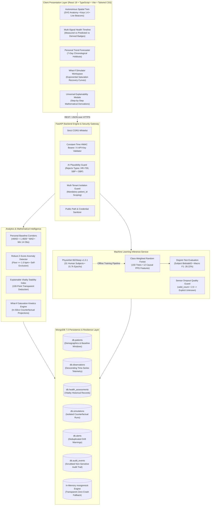

# SwasthyaTwin AI — System Architecture Specification & Diagram

**Project:** SwasthyaTwin AI — Personalized Multisignal Health Intelligence & Digital Twin  
**Submission:** Happiest Health Digital Twin Challenge 2026  
**Format:** Markdown Specification + Mermaid Vector Diagram + Vector PDF Export  
**Vector PDF Export:** [docs/architecture-diagram.pdf](file:///c:/Users/jaswant%20karun/SwasthyaTwin/docs/architecture-diagram.pdf)  

---

## 1. High-Resolution Architecture Diagram (Mermaid)

---

## 2. Layer-by-Layer Architectural Breakdown

### A. Client Presentation Layer
- **Framework:** React 19 with TypeScript, bundled using Vite v8.3.4 and styled with Tailwind CSS.
- **Visual Centerpiece:** The Autonomous Spatial Digital Twin holographic silhouette renders an anatomical SVG locator mapped to 6 grounded physiological subsystems (Cardiovascular, Sleep/Autonomic, Blood Pressure, Respiratory, Metabolic, Activity).
- **Navigation Hotkeys:** Keys `1` through `6` and arrow keys enable keyboard navigation across subsystems.
- **Explainability:** Universal `ExplanationModal` provides step-by-step arithmetic trails for every displayed metric, baseline corridor, anomaly flag, and Vitality deduction.

### B. FastAPI Application Gateway & Security
- **Strict Contracts:** Pydantic v2 schemas enforce canonical units (`bpm`, `mmHg`, `hours`, `steps`, `mg/dL`) and bounds checking.
- **AI Plausibility Guard:** Intercepts physiologically impossible vitals (e.g., heart rate of 999 bpm or systolic $\le$ diastolic blood pressure) with HTTP 409 conflict warnings before storage.
- **Tenant Isolation:** Enforces mandatory `{"patient_id": patient_id}` query scoping across all repository operations. Cross-patient data access returns HTTP 403 Forbidden.
- **Path & Secret Sanitization:** Public API endpoints automatically strip local server directory paths and mask database credentials.

### C. Analytics & Computation Engines
- **Robust Baseline Corridors:** Utilizes non-parametric median and normalized median absolute deviation ($nMAD = 1.4826 \times MAD$) with a safe variability floor ($\ge 1.0\text{ bpm}$) and target self-exclusion to prevent contamination.
- **Minimum History Gating:** Corridors require $\ge 14\text{ observations}$ before declaring statistical flags.
- **Vitality Index:** A deterministic 0–100 stability score where every deducted point is mathematically attributed to a specific metric's divergence.

### D. Machine Learning Inference Engine (PhysioNet BiDSleep)
- **Dataset Provenance:** PhysioNet Bimodal Sleep Dataset (BiDSleep v1.0.1, 31 healthy adults recorded with consumer optical smartwatch PPG and gold-standard Dreem 2 EEG polysomnography).
- **Partitioning:** Group-aware participant split (`Bidslab00` train, `Bidslab01` val, `Bidslab02` test) guaranteeing **0% participant leakage**.
- **Model:** Class-weighted Random Forest (150 trees, max depth 12) operating on 12 causal PPG features.
- **Performance:** Verified on held-out test participant `Bidslab02` (5,280 epochs / 44 hours): Macro F1 **28.22%** (+18.69% lift over majority baseline) and Balanced Accuracy **34.70%** (+14.70% lift).
- **Optical Dropout Guard:** If PPG samples in a 30s epoch are $< 2.0$, model returns an explicit `Unknown` label and `INSUFFICIENT_INPUT_DATA` flag rather than hallucinating sleep stages.

### E. Storage, Isolation & Database Resilience
- **Database:** MongoDB 7.0 with compound indexing on `patient_id` and descending timestamps.
- **Simulation Isolation:** Counterfactual What-If scenarios write strictly to `db.simulations` and **never contaminate** historical measured observations in `db.observations`.
- **Zero-Crash Fallback:** If the local MongoDB daemon is offline, the backend engages an in-memory `mongomock` engine, ensuring 100% crash-free demonstration readiness.

---

## 3. Submission Artifact Links
- **Architecture Diagram PDF**: [docs/architecture-diagram.pdf](file:///c:/Users/jaswant%20karun/SwasthyaTwin/docs/architecture-diagram.pdf)
- **Project Presentation Deck PDF**: [docs/project-presentation.pdf](file:///c:/Users/jaswant%20karun/SwasthyaTwin/docs/project-presentation.pdf)
- **Technical Architecture Specification**: [docs/architecture.md](file:///c:/Users/jaswant%20karun/SwasthyaTwin/docs/architecture.md)
- **Data Provenance Specification**: [docs/data-provenance.md](file:///c:/Users/jaswant%20karun/SwasthyaTwin/docs/data-provenance.md)
- **BiDSleep Model Card**: [docs/model-card.md](file:///c:/Users/jaswant%20karun/SwasthyaTwin/docs/model-card.md)
- **End-to-End Acceptance Test Report (282 Tests)**: [docs/final-test-report.md](file:///c:/Users/jaswant%20karun/SwasthyaTwin/docs/final-test-report.md)
