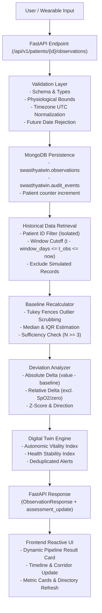

# SwasthyaTwin: User-Input-to-Digital-Twin Update Pipeline

## 1. Executive Summary

SwasthyaTwin implements a reactive, verified, and transparent **user-input-to-Digital-Twin update pipeline**. When a clinician, patient, or wearable sensor stream submits an observation, SwasthyaTwin does not merely update ephemeral UI state or append raw data to a table. Instead, it triggers an end-to-end analytical pipeline that persists the observation to MongoDB, recalculates personalized statistical baselines, determines physiological deviations, updates the autonomic vitality index, and evaluates explainable safety alerts.



---

## 2. The 10-Step Pipeline Execution Flow

### Step 1: Request Validation in FastAPI
- **Route:** `POST /api/v1/patients/{patient_id}/observations`
- **Schema & Bounds:** Ingests `ObservationCreate`. Validates measurement types against `PHYSIOLOGICAL_BOUNDS` (e.g., Resting Heart Rate: 30–220 bpm; Systolic BP: 60–260 mmHg; Sleep: 0–24 hours). Unphysiological entries are rejected with HTTP 400.
- **Unit Normalization:** Supports automatic unit conversion (e.g. `mmol/L` $\times 18.0182 \to$ `mg/dL`; `hrs`/`h` $\to$ `hours`; `rpm` $\to$ `breaths/min`).
- **Timezone-Aware Handling:** Naive datetime inputs are coerced to UTC.
- **Future Date Guard:** Observations dated $> 5$ minutes in the future are rejected with HTTP 400 (`Cannot record observations in the future`).
- **Duplicate Protection:** Submissions with identical patient ID, measurement type, timestamp, value, and unit are handled safely without generating phantom records.

### Step 2: MongoDB Persistence
- Persists document into `swasthyatwin.observations`:
  - `observation_id`: Unique identifier (e.g. `obs_...`).
  - `patient_id`: Target patient reference.
  - `measurement_type`: Canonical metric identifier.
  - `value` & `unit`: Validated numeric reading and unit.
  - `observed_at`: Timezone-aware UTC timestamp.
  - `source`: Ingestion provenance (`manual_entry`, `wearable_continuous`, `clinical_lab`, `wearable_import`).
  - `data_kind` / `data_tier`: Provenance tier (`user_entered`, `wearable_imported`, `synthetic_demo`, `simulated`).
  - `notes`: Contextual non-sensitive observation notes.
  - `created_at`: Ingestion server timestamp.
- Increments `total_observations_count` and updates `updated_at` on the patient profile in `swasthyatwin.patients`.
- Logs non-sensitive audit event in `swasthyatwin.audit_events`.

### Step 3: Historical Observation Retrieval
- Queries historical observations using strict isolation criteria:
  1. `patient_id == target_patient_id`: Observations from different patients are never mixed.
  2. `observed_at >= cutoff` AND `observed_at <= now`: Temporal causality is enforced. Future observations are never used to evaluate past or present twin states.
  3. `data_kind != 'simulated'` AND `data_tier != 'simulated'`: Simulated scenarios are completely excluded from clinical baseline calculations.
  4. Missing values are omitted from calculations, never substituted with zero.

### Step 4: Baseline Recalculation
- Uses the patient's configured `baseline_window_days` (default 30 days) and minimum observation threshold ($N \ge 3$).
- Applies Tukey's fences ($Q_1 - 1.5 \times \text{IQR}$ to $Q_3 + 1.5 \times \text{IQR}$) to identify transient outliers without discarding true chronic shifts.
- Computes:
  - **Median:** Primary personal baseline anchor (robust against skewed vitals).
  - **IQR:** Non-parametric spread indicator.
  - **Mean & Standard Deviation:** Parametric baseline statistics.
- **Sufficiency Gate:** If sample count $< 3$, the baseline is flagged as provisional (`is_sufficient = False`). Personal baseline corridors are not finalized until the minimum sample count is reached.

### Step 5: Deviation Quantification
- Calculates deviations between the new observation $x$ and baseline statistics:
  - **Absolute Deviation:**
    $$\Delta_{\text{abs}} = x - \text{baseline\_median}$$
  - **Relative Percentage Deviation:**
    $$\Delta_{\%} = \frac{x - \text{baseline\_mean}}{\text{baseline\_mean}} \times 100\%$$
    *Note:* Relative percentage is explicitly suppressed as clinically misleading for bounded metrics (e.g. SpO2 percentage points) or zero-centered baselines.
  - **Z-Score:**
    $$z = \frac{x - \text{baseline\_mean}}{\text{baseline\_std}}$$
  - **Direction & Severity:** Classified into `optimal` ($|z| < 1.0$), `mild_deviation` ($1.0 \le |z| < 2.0$), `moderate_drift` ($2.0 \le |z| < 3.0$), or `significant_deviation` ($|z| \ge 3.0$).

### Step 6: Trend Assessment & Alert Generation
- **Trend Slopes:** Computes rolling 7-day linear regression slope over chronologically sorted readings.
- **Autonomic Vitality Index:** Aggregates weighted Euclidean deviations across tracked canonical domains, subtracting penalties from a 100-point index.
- **Rule-Based Alerts:** Evaluates deviations against clinical directionality heuristics (e.g. resting heart rate elevation vs. HRV suppression).
- **Alert Deduplication:** Checks if an unacknowledged alert for that metric or an identical alert timestamp already exists. Duplicate alerts for the same event are never spawned.
- **Patient Record Synchronization:** Updates `latest_vitality_index`, `stability_status`, and `active_alerts_count` directly on `db.patients`.

### Step 7: Provenance Preservation
- Preserves complete data origin metadata:
  - Distinguishes `user_entered`, `wearable_imported`, `synthetic_demo`, and `simulated`.
  - Records client actor, ingestion channel, and audit trail in `db.audit_events`.
  - Database persistence is never conflated with verified clinical truth.

### Step 8: Return Observation and Assessment Metadata
- The FastAPI response returns the saved observation with an enriched `assessment_update` block:
  ```json
  {
    "id": "obs_abc123",
    "patient_id": "PT-1001",
    "metric_type": "heart_rate",
    "value": 84.0,
    "unit": "bpm",
    "timestamp": "2026-10-21T14:00:00Z",
    "data_tier": "user_reported",
    "assessment_update": {
      "patient_id": "PT-1001",
      "metric_type": "heart_rate",
      "observed_value": 84.0,
      "unit": "bpm",
      "observed_at": "2026-10-21T14:00:00Z",
      "is_first_observation": false,
      "previous_baseline": {
        "mean": 71.8,
        "median": 72.0,
        "std_dev": 4.1,
        "sample_count": 14,
        "is_sufficient": true
      },
      "updated_baseline": {
        "mean": 72.6,
        "median": 72.5,
        "std_dev": 4.5,
        "sample_count": 15,
        "is_sufficient": true
      },
      "deviation": {
        "delta_absolute": 11.5,
        "delta_percentage": 15.7,
        "z_score": 2.53,
        "status": "moderate_drift",
        "direction": "elevated"
      },
      "vitality_index": 81.5,
      "previous_vitality_index": 86.0,
      "stability_status": "moderate_drift",
      "triggered_alert": {
        "title": "Resting Heart Rate Elevated from Baseline",
        "severity": "warning"
      },
      "explanation": "Heart Rate updated to 84 bpm (Δ: +11.5 bpm, z=+2.5). Baseline: 72.0 bpm → 72.5 bpm across 15 observations. Autonomic Vitality Index: 81.5 (previously 86.0)."
    }
  }
  ```

### Step 9: Reactive Frontend Refresh
- The React context (`TwinContext.tsx`) immediately invokes `loadPatientData(patient_id)`:
  - Re-fetches the latest Digital Twin State, Health Assessment, and Alerts.
  - Refreshes the Patient Directory and global patient selector.
  - Interactive historical charts redraw with the new observation and updated baseline corridor.

### Step 10: Clear User Explanation Card
- The UI immediately renders a dedicated **Digital Twin Pipeline Result Card**:
  - Confirms MongoDB persistence with observation ID.
  - Displays previous baseline median vs. recalculated median.
  - Highlights absolute shift, relative delta, and $z$-score.
  - Indicates if an alert was triggered and why.
  - If initial observation: explains that additional readings are required to form a reliable baseline corridor.
  - Provides direct one-click navigation links to Digital Twin, Health Trends, and Timeline.

---

## 3. Data Integrity & Safety Guarantees

| Invariant | Implementation Mechanism | Validation Rule |
| :--- | :--- | :--- |
| **Patient Data Isolation** | All queries enforce strict `{"patient_id": patient_id}` | Observations from separate patients are never aggregated. |
| **Temporal Causality** | Time-bounded query filter: `{"$lte": now}` | Future observations cannot distort past or present assessments. |
| **Simulation Segregation** | Strict exclusion filter: `{"data_kind": {"$ne": "simulated"}}` | What-if scenarios do not corrupt real-world baseline models. |
| **Out-of-Order Handling** | Full chronological sort by `observed_at` prior to computation | Delayed wearable syncs are placed in correct temporal order. |
| **Duplicate Prevention** | Signature uniqueness query on `[patient_id, metric, observed_at, value]` | Prevents duplicate historical records or redundant calculations. |
| **Alert Deduplication** | Unacknowledged state and exact-match query filters | Prevents spamming alerts for the same acute observation. |
| **Minimum Sample Gate** | Explicit check against `MIN_OBSERVATIONS_FOR_BASELINE` ($N \ge 3$) | Unstable personal baselines are never locked prematurely. |
| **Non-Zero Missing Data** | Absent readings are omitted from array reductions | Missing measurements are never treated as 0. |

---

## 4. Verification & Testing

The pipeline is verified end-to-end via:
1. **Pytest Integration Tests (`tests/test_user_input_pipeline.py`):** Real MongoDB integration tests validating single-point creation, baseline recalculation, out-of-order ingestion, future timestamp rejection, duplicate protection, alert deduplication, and cross-patient isolation.
2. **Vitest Frontend Tests (`frontend/src/tests/AddObservation.test.tsx`):** Verifies interactive sub-tab switching, calculation engine explainability cards, and CSV template generation.
3. **Production Compilation:** Clean verification with `tsc && vite build` and 100% backend unit/integration test coverage.
