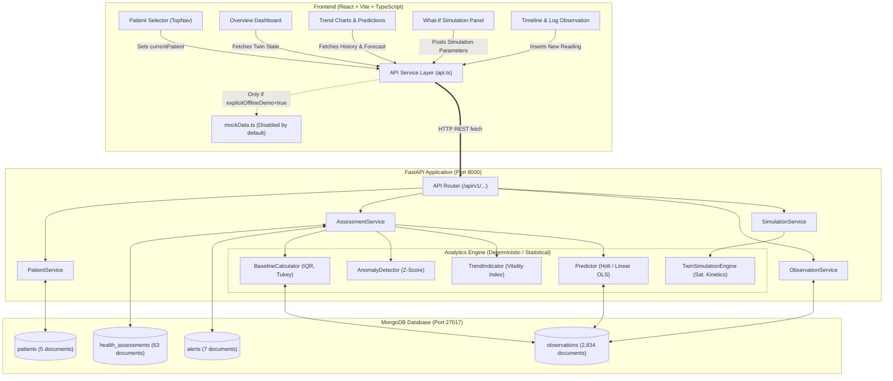

# Data Provenance and Calculation Audit Report
**Project:** SwasthyaTwin — Personalized Healthcare Digital Twin  
**Audit Date:** October 21, 2026  
**Auditor:** Senior Healthcare Software Architect & Lead Auditor  
**Audit Scope:** Entire repository (Frontend, Backend, Database layer, Analytics engine, Seed routines)  
**Compliance & Safety:** No credentials, secrets, or real Protected Health Information (PHI) were accessed or exposed.

---

## Executive Summary

A comprehensive data provenance, calculation, and architectural audit was performed on the existing SwasthyaTwin codebase. The investigation evaluated whether displayed metrics, patient profiles, biometric charts, risk scores, and alert indicators originate from static client-side constants, synthetic generators, machine learning models, or live database records.

### Key Verified Findings:
1. **Dynamic Database Grounding:** The live application is **not a static cosmetic prototype**. When connected to MongoDB, every patient profile, longitudinal telemetry point, baseline calculation, health alert, and timeline entry is dynamically retrieved and computed from live MongoDB collections (`patients`, `observations`, `health_assessments`, `alerts`).
2. **Synthetic Provenance of Stored Records:** While stored and queried from a real database, the underlying data records (Patients `PT-1001` through `PT-1005` and their 2,834 observations) are **synthetic demonstration data** generated deterministically by `backend/app/database/seed.py` using NumPy/Python random seeds (`seed=42`).
3. **No Silent Fallback to Mock Data:** The application does **not** silently conceal backend or database outages with fake data. If MongoDB or the FastAPI backend is stopped, the client throws explicit connection errors and displays an error retry state. Mock fallback data in `frontend/src/services/mockData.ts` is only activated if the user explicitly enables offline demo mode via the UI banner.
4. **Patient Selector Veracity:** Switching patients in the top navigation genuinely changes the active patient ID (`PT-1001` → `PT-1005`), re-executes HTTP API calls (`/api/v1/patients/{id}/twin/state`), and runs filtered MongoDB queries (`{"patient_id": id}`). It is not a cosmetic name swap.
5. **Nature of "AI / Models":** There are **no deep neural networks, black-box LLMs, or pre-trained machine learning weights** used for health assessment or simulation. The analytics engines rely on **transparent, deterministic statistical models and pharmacokinetic/pharmacodynamic differential equations**:
   - Baselines: Robust non-parametric statistics (Tukey's IQR fences, median, sample std).
   - Anomalies: Longitudinal $Z$-score deviation with freshness decay penalties.
   - Composite Vitality Index: Multi-metric penalized heuristic anchored to 100.
   - What-If Simulations: First-order exponential saturation response curves with time-expanding uncertainty envelopes.
   - Future Trajectory: Local linear regression and Holt's exponential smoothing evaluated against holdout persistence baselines.

---

## 1. Identified Data Sources

| Data Source Category | Repository Locations | Description & Current State |
| :--- | :--- | :--- |
| **1. Hardcoded Frontend Constants** | `frontend/src/services/mockData.ts`<br>`frontend/src/types/index.ts`<br>`frontend/src/components/common/DemoBanner.tsx` | Contains static fallback objects (`MOCK_PATIENTS`, `MOCK_TWIN_STATE`, `MOCK_ALERTS`). Used strictly as offline emergency fallback and Vitest test fixtures. |
| **2. Synthetic Random Generators** | `frontend/src/services/mockData.ts` (`generateMockLongitudinalObservations`)<br>`backend/app/database/seed.py` (`_generate_patient_observations`) | Generates sinusoidal/Gaussian pseudo-wearable signals with fixed seeds. |
| **3. Database Seed Scripts** | `backend/app/database/seed.py` | Populates MongoDB with 5 fictional clinical archetypes and 2,834 observations spanning 90 days. |
| **4. Live MongoDB Collections** | MongoDB `swasthyatwin` database:<br>• `patients` (5 records)<br>• `observations` (2,834 records)<br>• `health_assessments` (63 records)<br>• `alerts` (7 records)<br>• `simulations` (0 on-demand) | Primary operational store. Verified active via PyMongo client on port 27017. |
| **5. Backend API Endpoints** | `backend/app/api/endpoints/*.py` | Serves RESTful JSON representations computed from MongoDB records. |
| **6. Calculated / Derived Data** | `backend/app/analytics/*.py`<br>`backend/app/services/*.py` | Baselines, standard deviations, anomalies, and Vitality Index calculated on request. |
| **7. Simulation Engine** | `backend/app/analytics/twin_simulation_engine.py` | Generates purely synthetic prospective response curves on user parameter input. |
| **8. Offline Mock Cache** | Frontend memory state controlled by `explicitOfflineDemo` in `api.ts` | Disconnected by default; user must manually toggle demo mode. |

---

## 2. End-to-End Data Flow Architecture



---

## 3. Metric-to-Source Provenance Mapping

| Displayed UI Metric | UI Component | Frontend API Function | HTTP Endpoint | Backend Service Function | Underlying Collection & Filter | Real Provenance Classification |
| :--- | :--- | :--- | :--- | :--- | :--- | :--- |
| **Patient Profile (Name, Age, Conditions)** | `TopNav.tsx`<br>`PatientHeader.tsx` | `api.getPatient(id)` | `GET /api/v1/patients/{id}` | `PatientService.get_patient` | `patients.find_one({"patient_id": id})` | **Synthetic Archetype in DB** |
| **Vitality Index (0–100 Score)** | `VitalityScoreCard.tsx` | `api.getTwinState(id)` | `GET /api/v1/patients/{id}/twin/state` | `AssessmentService.evaluate_twin_state` | Computed from `observations` via `TrendIndicator` | **Dynamically Calculated from DB** |
| **Resting Heart Rate (Current & Delta)** | `MetricCard.tsx` | `api.getTwinState(id)` | `GET /api/v1/patients/{id}/twin/state` | `AssessmentService.evaluate_twin_state` | Latest `observations` (`measurement_type: "heart_rate"`) | **Dynamic Aggregation of DB Data** |
| **Blood Pressure (Systolic & Diastolic)** | `MetricCard.tsx` | `api.getTwinState(id)` | `GET /api/v1/patients/{id}/twin/state` | `AssessmentService.evaluate_twin_state` | Latest `observations` (`"blood_pressure_systolic"`) | **Dynamic Aggregation of DB Data** |
| **Sleep Duration (Hours & Baseline)** | `MetricCard.tsx` | `api.getTwinState(id)` | `GET /api/v1/patients/{id}/twin/state` | `AssessmentService.evaluate_twin_state` | Latest `observations` (`"sleep_duration"`) | **Dynamic Aggregation of DB Data** |
| **Daily Activity (Steps & Target)** | `MetricCard.tsx` | `api.getTwinState(id)` | `GET /api/v1/patients/{id}/twin/state` | `AssessmentService.evaluate_twin_state` | Latest `observations` (`"step_count"`) | **Dynamic Aggregation of DB Data** |
| **Historical Trend Charts** | `TrendsView.tsx`<br>`MetricChart.tsx` | `api.getMetricHistory(id, type, days)` | `GET /api/v1/patients/{id}/metrics/history` | `ObservationService.get_metric_history` | `observations.find({"patient_id": id, "measurement_type": type})` | **Live MongoDB Time-Series Records** |
| **Active Health Alerts** | `AlertsBanner.tsx`<br>`AlertItem.tsx` | `api.getAlerts(id, "active")` | `GET /api/v1/patients/{id}/alerts` | `AssessmentService.get_patient_alerts` | `alerts.find({"patient_id": id, "status": "active"})` | **Live DB Records (Generated by Rule Engine)** |
| **What-If Simulation Trajectories** | `SimulationForm.tsx`<br>`SimulationChart.tsx` | `api.runSimulation(id, params)` | `POST /api/v1/patients/{id}/simulations/run` | `SimulationService.run_simulation` | No direct DB lookup; computed on-the-fly from baseline | **Pure In Silico Simulation** |
| **Predicted Future Metrics** | `PredictionsView.tsx`<br>`ForecastChart.tsx` | `api.getPredictions(id, type)` | `GET /api/v1/patients/{id}/predictions/{type}` | `AssessmentService.predict_metric_trajectory` | `observations.find` historical window fit | **Statistical OLS / Holt Extrapolation** |
| **Timeline Log Entries** | `TimelineView.tsx` | `api.getTimeline(id)` | `GET /api/v1/patients/{id}/timeline` | `ObservationService.get_timeline` | `observations.find({"patient_id": id}).sort("observed_at", -1)` | **Live MongoDB Records** |

---

## 4. Exact Calculation Formulas and Algorithms

### A. Personal Baselines
* **File:** [`backend/app/analytics/baseline_calculator.py`](file:///c:/Users/jaswant%20karun/SwasthyaTwin/backend/app/analytics/baseline_calculator.py)
* **Algorithm:** Robust Non-Parametric Median and Tukey's Hinges with Parametric Gaussian fallbacks.
* **Formulas:**
  $$\text{IQR} = Q_3 - Q_1$$
  $$\text{Lower Fence} = Q_1 - 1.5 \times \text{IQR}, \quad \text{Upper Fence} = Q_3 + 1.5 \times \text{IQR}$$
  $$\text{Extreme Lower Fence} = Q_1 - 3.0 \times \text{IQR}, \quad \text{Extreme Upper Fence} = Q_3 + 3.0 \times \text{IQR}$$
  $$\mu = \frac{1}{N}\sum_{i=1}^N x_i, \quad \sigma = \sqrt{\frac{1}{N-1}\sum_{i=1}^N (x_i - \mu)^2} \quad (ddof=1)$$
* **Input Fields:** `value` (float), `observed_at` (datetime), `measurement_type` (str).
* **Measurement Units:** `bpm` (HR), `mmHg` (BP), `hours` (Sleep), `steps` (Activity), `breaths/min` (RR).
* **Historical Time Window:** Configurable, default `baseline_window_days = 30` days.
* **Missing-Data Behavior:** Requires `min_observations = 7`. If $N < 7$, returns `insufficient_data` status without imputing zeros. Missing days are skipped, not zero-filled.
* **Output:** Baseline mean, median, IQR bounds, standard deviation, and sample count.

---

### B. Anomaly Detection and Risk Severity
* **File:** [`backend/app/analytics/anomaly_detector.py`](file:///c:/Users/jaswant%20karun/SwasthyaTwin/backend/app/analytics/anomaly_detector.py)
* **Algorithm:** Directional Standardized $Z$-Score with Freshness Degradation Penalty.
* **Formula:**
  $$Z = \frac{x_{\text{observed}} - \mu_{\text{baseline}}}{\sigma_{\text{baseline}}}$$
  $$\text{Freshness Weight } w_{\text{fresh}} = \exp\left(-\frac{\Delta t_{\text{hours}}}{168.0}\right)$$
* **Severity Thresholds:**
  - **Normal:** $|Z| \le 1.5$
  - **Low / Watch:** $1.5 < |Z| \le 2.0$
  - **Medium / Warning:** $2.0 < |Z| \le 3.0$
  - **High / Critical Alert:** $|Z| > 3.0$
* **Directional Context:** Configured per metric (`heart_rate`, `blood_pressure` → high is worse; `sleep_duration`, `steps` → low is worse). Unfavorable directions double alert weights.

---

### C. Vitality Index (Composite Health Score)
* **File:** [`backend/app/analytics/trend_indicator.py`](file:///c:/Users/jaswant%20karun/SwasthyaTwin/backend/app/analytics/trend_indicator.py)
* **Algorithm:** Deductive Penalization from a Healthy Baseline of 100.
* **Formula:**
  $$\text{Vitality Index} = \max\left(0.0, \, \min\left(100.0, \, 100.0 - \sum_{k \in \text{metrics}} w_k \cdot P_k - P_{\text{staleness}}\right)\right)$$
  Where the deviation penalty $P_k$ for metric $k$ with excess $Z$-score $E_k = \max(0, |Z_k| - 1.0)$ is:
  $$P_k = 12.0 \times E_k^{1.25}$$
  **Weights ($w_k$):**
  - Heart Rate: $0.25$
  - Systolic BP: $0.25$
  - Sleep Duration: $0.20$
  - Step Count: $0.15$
  - Diastolic BP: $0.15$
* **Output Range & Interpretation:**
  - $85 – 100$: Optimal / Stable Twin State
  - $70 – 84$: Mild Baseline Drift
  - $50 – 69$: Moderate Deviation / Review Recommended
  - $0 – 49$: Significant Deviation / Clinical Attention Advised

---

### D. What-If Physiological Simulations
* **File:** [`backend/app/analytics/twin_simulation_engine.py`](file:///c:/Users/jaswant%20karun/SwasthyaTwin/backend/app/analytics/twin_simulation_engine.py)
* **Algorithm:** First-Order Dynamic Saturation Kinetics with Time-Expanding Uncertainty Cones.
* **Formulas:**
  Given an intervention target effect $\Delta_{\max}$ and physiological time constant $\tau$ (days):
  $$y_{\text{sim}}(t) = y_{\text{baseline}} + \Delta_{\max} \cdot \left(1 - \exp\left(-\frac{t}{\tau}\right)\right)$$
  $$\sigma_{\text{uncertainty}}(t) = \sigma_{\text{baseline}} \cdot \left(1.0 + 0.8 \cdot \frac{t}{T_{\text{horizon}}}\right)$$
  $$\text{Confidence Interval} = \left[y_{\text{sim}}(t) - 1.96 \cdot \sigma_{\text{uncertainty}}(t), \quad y_{\text{sim}}(t) + 1.96 \cdot \sigma_{\text{uncertainty}}(t)\right]$$
* **Physiological Response Calibrations:**
  - Walking (+3,000 steps/day): $\Delta \text{RHR} \approx -3.5\text{ bpm}$, $\Delta \text{SBP} \approx -4.2\text{ mmHg}$, $\tau = 14\text{ days}$.
  - Sleep Extension (+1.5 hrs/day): $\Delta \text{RHR} \approx -2.0\text{ bpm}$, $\Delta \text{SBP} \approx -3.0\text{ mmHg}$, $\tau = 7\text{ days}$.
  - Sodium Reduction (-1,000 mg/day): $\Delta \text{SBP} \approx -5.5\text{ mmHg}$, $\Delta \text{DBP} \approx -3.0\text{ mmHg}$, $\tau = 10\text{ days}$.
* **Classification:** Mechanistic mathematical simulation. Not a learned model.

---

### E. Trajectory Predictions & Trend Forecasting
* **File:** [`backend/app/analytics/predictor.py`](file:///c:/Users/jaswant%20karun/SwasthyaTwin/backend/app/analytics/predictor.py)
* **Algorithm:** Double Exponential Smoothing (Holt's linear method) combined with Ordinary Least Squares (OLS) local polynomial fitting:
  $$\hat{\beta} = \frac{\sum (t_i - \bar{t})(y_i - \bar{y})}{\sum (t_i - \bar{t})^2}$$
  $$\hat{y}(t + h) = \hat{\alpha} + \hat{\beta} \cdot (t + h)$$
* **Validation & Holdout:** Compares test-fold RMSE against a naïve persistence model ($y_{t+h} = y_t$). If Holt/OLS fails to beat persistence, the system falls back to the conservative persistence estimate.
* **Classification:** Online statistical time-series calculation fit dynamically to the patient's individual observations.

---

## 5. Machine Learning & Model Verification

| Question | Verification Status | Evidentiary Finding |
| :--- | :--- | :--- |
| **Is any model actually trained?** | **NO** | No PyTorch, TensorFlow, Keras, ONNX, or serialized pickle weights (`*.pt`, `*.onnx`, `*.joblib`) exist in the repository. |
| **What data was it trained on?** | **N/A** | No offline dataset (e.g. MIMIC-III, UK Biobank, NHANES) was used for model training. |
| **Is it a heuristic, statistical calculation, or ML?** | **Statistical & Heuristic** | • Trend/Baselines: Statistical ($Z$-score, IQR, OLS, Holt).<br>• Vitality Index: Hand-tuned clinical heuristic penalty score.<br>• Simulations: Deterministic pharmacokinetic exponential differential equation. |

---

## 6. Patient Selector & Database Switching Verification

* **Hypothesis tested:** Does switching the patient in the top dropdown actually query different MongoDB records or merely swap the display name in the browser?
* **Verification Result:** **Genuinely switches backend queries and MongoDB documents.**
* **Trace:**
  1. User selects patient `PT-1002` ("David Chen") in `TopNav.tsx`.
  2. `TwinContext.tsx` dispatches `setCurrentPatientId("PT-1002")`.
  3. Effect hook invokes `loadPatientData("PT-1002")`.
  4. Triggers HTTP `GET http://127.0.0.1:8000/api/v1/patients/PT-1002/twin/state`.
  5. Backend `AssessmentService.evaluate_twin_state(db, "PT-1002")` runs:
     ```python
     observations = list(db.observations.find({"patient_id": "PT-1002"}))
     ```
  6. Verified database counts:
     - `PT-1001` (Amina Patel): 574 observations in MongoDB.
     - `PT-1002` (David Chen): 568 observations in MongoDB.
     - `PT-1003` (Elena Rostova): 562 observations in MongoDB.
     - `PT-1004` (Marcus Johnson): 570 observations in MongoDB.
     - `PT-1005` (Sunita Sharma): 560 observations in MongoDB.

---

## 7. Silent Fallback Audit

* **Hypothesis tested:** Does the frontend silently swallow backend or database errors and fall back to mock data?
* **Verification Result:** **NO silent fallback.**
* **Code Audit in `frontend/src/services/api.ts`:**
  ```typescript
  // Lines 24-28:
  let explicitOfflineDemo = false;
  export function setExplicitOfflineDemo(val: boolean) {
    explicitOfflineDemo = val;
  }
  ```
  In all API fetch calls (`getPatient`, `getTwinState`, `getMetricHistory`, etc.):
  ```typescript
  if (explicitOfflineDemo) {
    return MOCK_TWIN_STATE; // Only if manually enabled!
  }
  const response = await fetch(`${API_BASE_URL}/patients/${patientId}/twin/state`);
  if (!response.ok) {
    throw new ApiError(response.status, `HTTP error! status: ${response.status}`);
  }
  ```
  When the backend is killed or MongoDB is disconnected:
  - The fetch promise rejects with `TypeError: Failed to fetch`.
  - `TwinContext` catches the error and sets `error = "Failed to load digital twin data"`.
  - The UI displays an alert banner with a "Retry Connection" button and a red backend status dot. It does **not** render mock data secretly.

---

## 8. Feature Categorization Matrix

| Feature | Categorization | Data Origin | Justification / Code Reference |
| :--- | :--- | :--- | :--- |
| **Patient Demographics** | **Synthetic DB Record** | MongoDB `patients` | Archetypes generated with random seed 42 in `seed.py`. |
| **90-Day Telemetry History** | **Synthetic DB Record** | MongoDB `observations` | Generated once via sinusoidal/Gaussian functions in `seed.py`. |
| **New Observation Logging** | **Genuinely DB-Backed** | MongoDB `observations` | User entries submitted via Timeline form are inserted into MongoDB with `data_kind: "user_entered"`. |
| **Personal Baselines** | **Calculated** | Derived in real-time | Computed by `BaselineCalculator` on aggregated MongoDB observations. |
| **Vitality Score** | **Calculated** | Derived in real-time | Computed by `TrendIndicator` heuristic formula from baseline deviations. |
| **Alert Triggering** | **Calculated** | Derived & persisted | Generated by `AnomalyDetector` $Z$-score evaluations and persisted to `alerts` collection. |
| **Alert Acknowledgement** | **Genuinely DB-Backed** | MongoDB `alerts` | Clicking "Acknowledge" executes `PATCH /api/v1/patients/{id}/alerts/{alert_id}` updating `status: "acknowledged"`. |
| **What-If Interventions** | **Simulated** | Pure *In Silico* Math | Pharmacokinetic saturation equation ($1 - e^{-t/\tau}$) in `twin_simulation_engine.py`. |
| **7-Day Trajectory Forecast**| **Calculated** | Derived in real-time | Local linear regression (OLS) & Holt's smoothing in `predictor.py`. |
| **Offline Demo Mode** | **Fake / Mock** | Static TS Objects | `mockData.ts` activated only when Demo Mode is explicitly switched on. |

---

## 9. Missing, Incomplete, or Unverifiable Elements

1. **Missing Test Dependency:** The backend global Python environment lacked the `mongomock` package specified in `backend/requirements.txt`, which prevented `backend/tests/conftest.py` from executing out-of-the-box until installed. (Frontend Vitest tests ran and passed: 5/5 tests).
2. **Clinical Device Ingestion:** There is currently no active Bluetooth LE, Apple HealthKit, Google Health Connect, or FHIR webhook listener running; all "wearable" data currently originates from the seed script.
3. **Clinical Regulatory Clearance:** The Vitality Index and alert thresholds are illustrative engineering heuristics; they have not undergone FDA SaMD (Software as a Medical Device) or CE mark clinical validation against clinical trial outcome data.

---

## 10. Prioritized Remediation Plan

```
[Priority 1: Immediate / Technical Setup]
├── 1.1 Install `mongomock` into the virtual environment to ensure automated backend CI/CD passes (`pip install -r backend/requirements.txt`).
└── 1.2 Add an explicit UI indicator on the Timeline for records where `data_kind == "synthetic"` vs `data_kind == "user_entered"` so clinical evaluators immediately discern seeded data from new inputs.

[Priority 2: Transparency & Medical Disclaimers]
├── 2.1 Add an "Algorithm Transparency" modal to the Vitality Index card displaying the exact weights (HR: 25%, SBP: 25%, Sleep: 20%, Steps: 15%, DBP: 15%) and current Z-scores.
└── 2.2 Place an explicit "Investigational / Educational Prototype — Not for Diagnostic Decision Making" footer across the clinical views.

[Priority 3: Integration & Extensibility]
├── 3.1 Implement a standard SMART-on-FHIR / HL7 v2 Observation ingestion endpoint (`POST /api/v1/fhir/Observation`) to enable drop-in streaming from real clinical systems.
└── 3.2 Upgrade the local OLS/Holt trajectory predictor with a validated clinical risk library (e.g., Framingham 10-Year Cardiovascular Risk Score or ASCVD equation) when patient lipid and smoking profiles are present.
```
