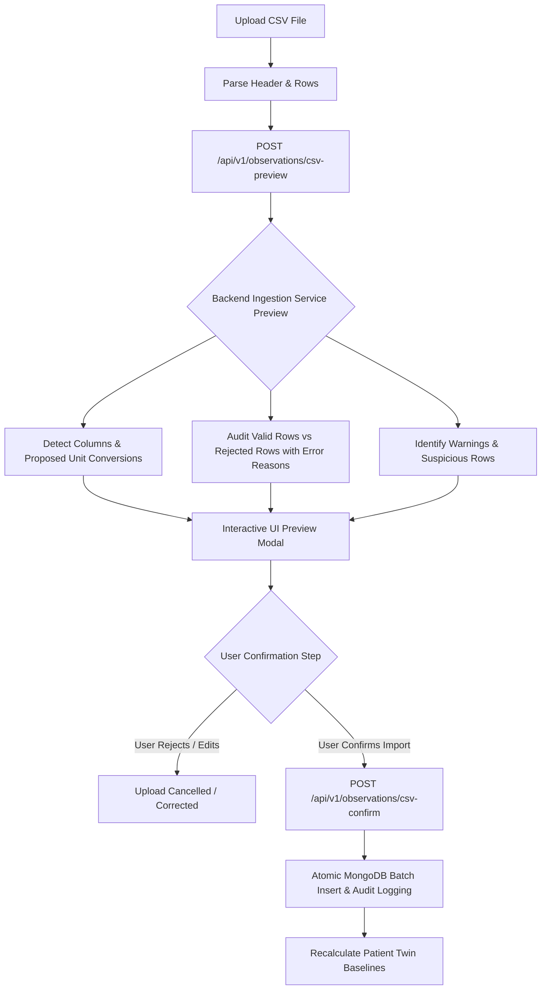

# SwasthyaTwin AI — Health Data and Input Quality Layer
**Document Version:** 1.0.0  
**Specification Date:** October 2026  
**Scope:** Data Ingestion, Verification, Plausibility Checks, Prediction Safeguards, and Provenance Architecture  
**Target Repository:** SwasthyaTwin — Digital Twin Platform  

---

## 1. Executive Summary & Purpose

The **SwasthyaTwin Health Data and Input Quality Layer** guarantees that incorrect, ambiguous, inconsistent, or unsupported user input **cannot silently produce misleading predictions or clinical visualizations**. 

In high-stakes physiological digital twin modeling, poor data quality poses severe safety risks:
1. **Garbage-In, Garbage-Out (GIGO):** An accidental digit transposition (e.g. entering `175` instead of `75` bpm) can falsely trigger tachycardia emergency alerts or degrade long-term baseline corridors.
2. **Silent Failure & Overconfidence:** Running machine learning inference when critical physiological signals are missing, stale, or imputed as zero yields deceptive, confident-looking predictions.
3. **Loss of Provenance:** Conflating synthetic simulation data, public benchmark datasets, and real user biometric records poisons personal baselines.

This document details the architectural rules, validation corridors, unit conversions, CSV ingestion workflows, prediction safeguards, and data governance standards implemented across the SwasthyaTwin platform.

---

## 2. Ingestion Channels & Complete Provenance Schema

All incoming observations—regardless of ingress mechanism—flow through a single validated `IngestionService` (`backend/app/services/ingestion_service.py`). 

### 2.1 The Five Provenance Channels

| Channel | `source_type` | `data_classification` | Description & Baseline Behavior |
| :--- | :--- | :--- | :--- |
| **Manual Entry** | `manual_entry` | `user_entered` | Self-reported via mobile or web portal. Subject to interactive verification modals. |
| **Imported File** | `imported_file` | `wearable_imported` | Bulk CSV files from consumer wearables (Fitbit, Garmin, Apple Health). Subject to pre-verification preview. |
| **Device Measurement** | `device_measurement` | `wearable_imported` | Direct BLE or verified sensor stream (e.g., Polar H10, Withings BP cuff). |
| **Public Research Dataset** | `public_research_dataset` | `research_benchmark` | Public benchmark cohorts (e.g. Stanford COVID-19, PhysioNet). **Strictly isolated from personal patient baselines.** |
| **Synthetic Demo** | `synthetic_demo` | `synthetic_demo` | Demonstrative or synthetic simulation records. Flagged with distinct UI badges. |

### 2.2 Canonical Observation Schema

For every observation, SwasthyaTwin immutably records:
- **`patient_id`**: String patient identifier (e.g., `PT-1001`).
- **`metric_type`**: Canonical metric identifier (e.g., `resting_heart_rate`, `blood_glucose`).
- **`value`**: Numeric float converted into the metric's canonical unit.
- **`unit`**: Canonical metric unit string (e.g., `bpm`, `mg/dL`, `mmHg`).
- **`raw_value` & `raw_unit`**: The exact value and unit entered prior to conversion.
- **`timestamp`**: ISO-8601 UTC timestamp including timezone offset where applicable.
- **`source_type`**: Ingestion channel (`manual_entry`, `imported_file`, `device_measurement`, `public_research_dataset`, `synthetic_demo`).
- **`device_id`**: Hardware identifier, BLE UUID, or filename if imported.
- **`validation_status`**: Tri-state verification flag: `verified`, `flagged_unusual`, or `rejected`.
- **`validation_warnings`**: Array of human-readable data quality warnings generated during intake.
- **`created_at`**: Immutable UTC ingestion timestamp.
- **`edit_history`**: Append-only audit trail logging user corrections, reasons, prior values, and timestamps.

---

## 3. Explicit Unit Conversions & Canonical Units

SwasthyaTwin enforces explicit, tested unit conversions (`backend/app/analytics/unit_converter.py`). Observations are normalized to canonical units upon ingestion to ensure baseline calculations and machine learning features operate on consistent scales:

| Physiological Metric | Canonical Unit | Supported Alternate Units | Conversion Formula |
| :--- | :--- | :--- | :--- |
| **Fasting Blood Glucose** | `mg/dL` | `mmol/L` | $\text{mg/dL} = \text{mmol/L} \times 18.0182$ |
| **Systolic / Diastolic BP** | `mmHg` | `kPa` | $\text{mmHg} = \text{kPa} \times 7.50062$ |
| **Sleep Duration** | `hours` | `minutes`, `mins` | $\text{hours} = \text{minutes} / 60.0$ |
| **Body Weight** | `kg` | `lbs`, `pounds` | $\text{kg} = \text{lbs} / 2.20462$ |
| **Body Temperature** | `C` | `F`, `fahrenheit` | $\text{C} = (F - 32.0) \times \frac{5}{9}$ |
| **Resting Heart Rate** | `bpm` | `beats/min`, `hz` | Canonical: `bpm` (Hz converted via $\times 60$) |
| **HRV RMSSD** | `ms` | `s` | $\text{ms} = \text{s} \times 1000.0$ |
| **Daily Step Count** | `steps` | `count` | Direct integer representation |

---

## 4. Configurable Plausibility Corridors

Plausibility checks separate **technically impossible measurements** from **unusual or suspicious values**.

> [!IMPORTANT]
> **Data-Quality Rule vs. Clinical Threshold:**  
> Plausibility corridors are designed to intercept data-entry errors, unit mismatches, and sensor malfunctions. They are **not** universal clinical decision thresholds or diagnostic criteria.

### 4.1 Plausibility Limits & Clinical Reference Sources

| Metric | Hard Technical Range (400 Bad Request) | Plausible Resting Corridor (409 Confirmation Required) | Authoritative Reference Source |
| :--- | :--- | :--- | :--- |
| **Resting Heart Rate** | $20 - 300\text{ bpm}$ | $35 - 180\text{ bpm}$ | AHA Guidelines & ISO 81060-2 |
| **Systolic Blood Pressure** | $40 - 300\text{ mmHg}$ | $70 - 200\text{ mmHg}$ | AHA/ACC 2017 Hypertension Guidelines |
| **Diastolic Blood Pressure** | $20 - 200\text{ mmHg}$ | $40 - 130\text{ mmHg}$ | AHA/ACC 2017 Hypertension Guidelines |
| **Blood Glucose** | $20 - 800\text{ mg/dL}$ | $50 - 350\text{ mg/dL}$ | American Diabetes Association (ADA) 2024 Standards |
| **Oxygen Saturation ($SpO_2$)** | $50 - 100\%$ | $85 - 100\%$ | WHO Pulse Oximetry Guidance |
| **Sleep Duration** | $0.2 - 24.0\text{ hours}$ | $2.0 - 16.0\text{ hours}$ | National Sleep Foundation (NSF) |
| **Daily Step Count** | $0 - 150,000\text{ steps}$ | $0 - 45,000\text{ steps}$ | Wearable Sensor Ergonomics |
| **Body Weight** | $1.0 - 500.0\text{ kg}$ | $25.0 - 250.0\text{ kg}$ | CDC Growth & Anthropometric Standards |
| **Body Temperature** | $30.0 - 45.0^\circ\text{C}$ | $35.0 - 41.5^\circ\text{C}$ | Clinical Thermometry Guidelines |

### 4.2 Multi-Variate Consistency Checks
SwasthyaTwin validates interrelated biometrics simultaneously:
- **Diastolic $\ge$ Systolic Inversion:** If diastolic blood pressure is greater than or equal to systolic blood pressure (e.g. Systolic 80, Diastolic 120), the input is rejected outright with an actionable error.
- **Extreme Pulse Pressure:** If pulse pressure ($\text{Systolic} - \text{Diastolic}$) is less than $10\text{ mmHg}$ or greater than $120\text{ mmHg}$, the reading is flagged as physically suspicious.

### 4.3 Temporal Checks & Duplicate Detection
- **Future Timestamps:** Observations with timestamps more than 5 minutes in the future are rejected.
- **Historical Boundaries:** Observations dated prior to Unix epoch (1970-01-01) or more than 10 years in the past are rejected.
- **Duplicate Observations:** Observations with identical `(patient_id, metric_type, timestamp, value)` tuples are intercepted to prevent skewed baseline statistics.

---

## 5. User Interaction & Suspicious Value Confirmation (HTTP 409)

When an observation falls within the technically possible range but outside typical resting corridors (e.g., Resting Heart Rate = 175 bpm):

1. **No Silent Changes or Deletions:** SwasthyaTwin never modifies or deletes suspicious values behind the scenes.
2. **HTTP 409 Conflict Response:** The backend returns status `409 Conflict` with `requires_confirmation: true`, a list of warnings, and heuristic typo suggestions (e.g. checking if `175` was a digit transposition for `75`).
3. **Interactive Confirmation Dialog:** The frontend displays an urgent verification dialog explaining why the reading is unusual and provides two explicit options:
   - **Confirm & Record As Is:** The user affirms the reading is genuine (e.g., post-strenuous exercise), persisting it with `validation_status="flagged_unusual"` and `confirmed_by_user=true`.
   - **Edit Measurement:** The user corrects the value directly or accepts a suggested typo fix without navigating away.

---

## 6. CSV Batch Ingestion Workflow

To prevent corrupt or misaligned batch uploads, CSV imports follow a mandatory two-phase commit:



---

## 7. Prediction Safeguards & Feature Readiness Audits

Machine learning inference must never operate on missing, fabricated, or severely degraded inputs. Prior to executing predictions (`backend/app/analytics/prediction_safeguards.py`):

### 7.1 The Zero-Imputation Prohibition
> [!CAUTION]
> **Strict Prohibition on Zero-Imputation:**  
> SwasthyaTwin **never infers that an unmeasured or missing physiological signal is zero**. Missing blood glucose, blood pressure, or HRV is fundamentally different from a value of `0.0`. Imputing zeros creates catastrophic model artifacts (e.g. fatal hypoglycemia or cardiogenic shock predictions).

### 7.2 Freshness and Availability Audits
- **Required Feature Schema:** The model verifies that required features (`heart_rate`, `systolic_bp`, `diastolic_bp`, `hrv_rmssd`, `sleep_duration`, `daily_steps`) are present.
- **Freshness Thresholds:**
  - **Fresh ($\le 30\text{ days}$):** Valid for real-time risk assessment and digital twin synchronization.
  - **Aging ($31 - 90\text{ days}$):** Permitted with high-visibility epistemic uncertainty warnings.
  - **Expired ($> 90\text{ days}$):** Rejected; prediction is withheld until current telemetry is synchronized.
- **Missingness Limits:** If more than 2 core features are missing, inference is aborted.

### 7.3 Structured Prediction Response
When predictions are evaluated, the API returns a structured transparency payload:
```json
{
  "status": "ready",
  "prediction": {
    "vitality_delta_14d": 3.42,
    "projected_vitality": 87.9,
    "risk_cluster_id": 0,
    "risk_label": "Low Risk (Resilient)"
  },
  "units": "points",
  "model_version": "2.4.0-ml-ensemble",
  "warnings": [],
  "limitations": [
    "Trained on physiological observations with 14-day rolling baselines.",
    "Projections assume stable medication and routine lifestyle patterns.",
    "Data quality checks verify mathematical format, not medical ground truth."
  ],
  "data_provenance": {
    "patient_id": "PT-1001",
    "feature_count_available": 6,
    "feature_count_required": 6,
    "evaluated_at": "2026-10-22T21:45:00Z"
  }
}
```

If inputs fail quality checks, `status` is set to `insufficient_data` or `stale_data`, `prediction` is `null`, and understandable explanations are returned explaining exactly what data must be refreshed.

---

## 8. Patient Baseline Isolation Guarantee

To protect the integrity of individualized digital twins:
1. **No Merging with Public Research Data:** Public research datasets (e.g. Stanford COVID-19, PhysioNet) used to train models or benchmark algorithms are **strictly partitioned** into separate collections and isolated pipelines. They are never blended into a real patient's historical baseline corridor.
2. **Multi-Tenant Patient Partitioning:** All database queries, baseline calculations, and audit logs filter strictly by `patient_id`.
3. **No Synthetic Pollution:** Synthetic demonstration records are tagged with `data_classification="synthetic_demo"` and excluded from clinical cohort statistics.

---

## 9. Algorithmic Data Quality & Medical Disclaimer

> [!WARNING]
> **Data Quality Disclaimer:**  
> The SwasthyaTwin Data Quality and Ingestion Layer validates syntactic correctness, unit consistency, range boundaries, and multivariate mathematical plausibility.  
> **Validation checks do not guarantee that input data is medically accurate, nor do they replace professional clinical evaluation, diagnostic judgment, or laboratory verification.**  
> Users and clinicians must evaluate all digital twin simulations within the context of complete patient clinical history.
