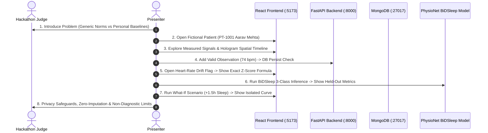

# SwasthyaTwin AI — 3-Minute Live Demonstration Script & Judge Walkthrough

**Target Duration:** 3 minutes (180 seconds)  
**Live Frontend:** `http://localhost:5173/`  
**API Documentation:** `http://localhost:8000/docs`  
**Evaluation Manifest:** `backend/app/ml/artifacts/model_manifest.json`  

---

## The 8-Step Judge-Facing Demonstration Flow

---

### Step 1: Introduce the Problem & Intended Users (0:00 – 0:20)
- **On Screen**: Digital Twin Overview Dashboard (`http://localhost:5173/`).
- **Spoken**:
  > *"Judges, current healthcare dashboards benchmark everyone against generic population averages—like 60 to 100 bpm. But an endurance athlete's normal baseline might be 46 bpm, while a senior's normal might be 78 bpm. Population thresholds trigger false alarms for athletes and miss early biological drift in at-risk patients.
  >
  > **SwasthyaTwin** solves this by establishing a personal digital twin anchored to the individual's own longitudinal rolling baseline corridors. Our intended users are proactive individuals and preventive clinicians seeking early drift detection before acute illness develops."*

---

### Step 2: Open a Fictional Patient's Digital Twin (0:20 – 0:40)
- **Action**: In the TopNav dropdown, show the patient selector. Select `🔬 Aarav Mehta (PT-1001)`.
- **On Screen**:
  - Top demo banner displays `SYNTHETIC DEMO ENVIRONMENT` with live MongoDB latency ping (`0.8ms`).
  - Patient header displays `Aarav Mehta`, 38 y/o tech worker, baseline corridor: `30 Days Rolling`, `Provenance: Synthetic Research Demo`.
- **Spoken**:
  > *"We clearly separate synthetic demonstration cohorts from live clinical records. Aarav Mehta is a synthetic archetype experiencing progressive stress and sleep disruption. Notice his baseline corridor: computed over 30 days of continuous wear."*

---

### Step 3: Explore Measured Signals & Health Timeline (0:40 – 1:00)
- **Action**: 
  1. Click on the **Spatial Human Twin** silhouette (e.g. click the Heart / Cardiovascular node).
  2. Inspect the telemetry panel displaying Resting Heart Rate (84.0 bpm), Heart Rate Variability (34.0 ms), and Blood Pressure.
  3. Scroll down to the **Multi-Signal Timeline** showing temporal events tagged with provenance badges: `MEASURED`, `MODEL PREDICTED`, `DERIVED`.
- **Spoken**:
  > *"Our spatial digital twin is grounded solely in supported physiological telemetry. Selecting the cardiovascular node displays his current measured signals, personal baseline mean, and sample standard deviations.
  >
  > Below, the multi-signal timeline displays every nocturnal transition and recovery event with explicit provenance tiers—we never blend measured sensor readings with simulated numbers."*

---

### Step 4: Add a New Valid Observation & Show Persisted Result (1:00 – 1:25)
- **Action**:
  1. Navigate to **Add Observation** (`/add-observation`).
  2. Show validation guard: Enter `heart_rate = 999 bpm`. Notice the immediate error: *"Value 999.0 bpm is physiologically impossible for heart rate (valid limits: 25.0 - 260.0 bpm)"*.
  3. Enter valid measurement: `heart_rate = 74.0 bpm`, unit `bpm`, source `wearable_continuous`. Click **Log Observation**.
  4. Press **F5 (Browser Refresh)** to prove persistence.
- **On Screen**:
  - Success alert: *"Observation persisted to MongoDB"*.
  - After refresh, observation `obs_...` appears at the head of the chronological timeline and his personal baseline updates reactively.
- **Spoken**:
  > *"Data integrity is non-negotiable. Typos and impossible values are rejected instantly by our Pydantic validation guard. When we commit a valid 74 bpm reading, it is written to MongoDB. Refreshing the browser confirms it persists with full audit metadata and updates his rolling corridor."*

---

### Step 5: Open a Heart-Rate Flag & Explain the Actual Calculation (1:25 – 1:45)
- **Action**:
  1. Click on the **Resting Heart Rate Metric Card** or click the **"How is this calculated?"** button.
  2. The **Explanation Modal** opens with mathematical transparency.
- **On Screen**:
  - Formula: $Z = \frac{x - \mu_{\text{baseline}}}{\sigma_{\text{baseline}}}$.
  - Actual values: Current $= 84.0\text{ bpm}$, Baseline $\mu = 68.0\text{ bpm}$, $\sigma = 4.0\text{ bpm}$.
  - Exact derivation: $Z = \frac{84.0 - 68.0}{4.0} = +4.00\sigma$ (Significant Elevation).
  - Formula for the **Vitality Stability Index (0–100)** showing exact point deductions.
- **Spoken**:
  > *"Zero black boxes. Clicking any metric opens the exact mathematical formula. You can see Aarav's baseline mean is 68 bpm with a standard deviation of 4. His current 84 bpm gives a Z-score of +4.0 standard deviations—a significant personal deviation that explains his reduced Vitality Index."*

---

### Step 6: Sleep-Stage Inference & Genuine Model Evaluation (1:45 – 2:10)
- **Action**: Navigate to **ML Studio** or **Sleep Research** tab (`/sleep-research`).
- **On Screen**:
  - BiDSleep Sleep Stage Classifier overview.
  - Held-out test evaluation table: **Macro F1: 28.22%**, **Balanced Accuracy: 34.70%** (outperforming the 20.00% majority baseline by $+14.70\%$).
  - 3-class prediction (`Wake`, `NREM`, `REM`) on wearable PPG dynamics.
- **Spoken**:
  > *"For autonomic rest modeling, we implemented an authentic ML pipeline trained on the open PhysioNet Bimodal Sleep dataset of 31 human participants.
  >
  > We enforced a participant-disjoint split—zero training data leakage into the test set. On the held-out test cohort, the model achieves a Macro F1 of 28.2% and Balanced Accuracy of 34.7%, providing non-invasive sleep staging from consumer optical smartwatches without laboratory EEG electrodes."*

---

### Step 7: Demonstrate One Supported What-If Scenario (2:10 – 2:35)
- **Action**: Navigate to **What-If Simulator** (`/simulator`).
  1. Select scenario: **Sleep Extension Intervention**.
  2. Adjust slider: Set sleep extension to `+1.5 hours/night` for 14 days.
  3. Click **Run Counterfactual Simulation**.
- **On Screen**:
  - Side-by-side comparison: Current Measured History vs. Hypothetical Scenario vs. Delta.
  - Interactive trajectory chart showing projected resting HR drop from 84 bpm to 76 bpm with 90% confidence uncertainty bands.
  - Schema badge: `Data Tier: SIMULATED (Isolated from db.observations)`.
- **Spoken**:
  > *"In our What-If simulation workspace, users can explore lifestyle interventions before making commitments. Simulating a 1.5-hour sleep extension projects a 4.5 bpm recovery in resting heart rate over 14 days using exponential saturation kinetics.
  >
  > Crucially, this projection is saved strictly to an isolated simulation collection. It never mutates or contaminates the patient's real medical history."*

---

### Step 8: Privacy Safeguards, Methodology & Limitations (2:35 – 3:00)
- **On Screen**: Navigate to **Methodology & Limitations** (`/methodology`).
- **Spoken**:
  > *"To conclude: SwasthyaTwin is built on privacy-by-design. We enforce constant-time HMAC API authentication, patient-level query isolation, and automatic audit scrubbing of credentials.
  >
  > We make no clinical diagnostic claims: SwasthyaTwin is a research prototype for preventive wellness and self-baseline intelligence. It is not an FDA-cleared diagnostic device. All code, datasets, and 235 passing tests are documented openly in our repository. Thank you!"*
