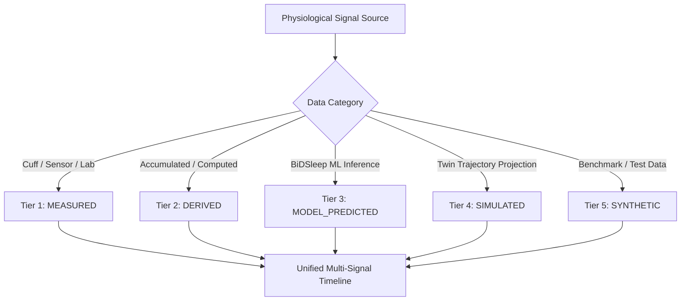

# SwasthyaTwin AI — Health Data Integration & Multi-Signal Architecture

## 1. Executive Summary

This document specifies the unified health observation and analytics architecture for **SwasthyaTwin AI**. It defines the canonical data models, unit standards, data provenance tiers, data-quality rules, multi-signal timeline co-registration, and safety constraints that govern all physiological data within the platform.

The core principle of SwasthyaTwin AI is **Zero Fabrication & Strict Provenance Integrity**:
- Data from medical cuffs, wearable sensors, machine learning pipelines, and statistical engines are unified into a single coherent timeline without duplicating MongoDB collections or competing calculation engines.
- Blood pressure is treated strictly as **ground-truth measured data** and is **never inferred or estimated from heart rate or photoplethysmography (PPG)**.
- Missing telemetry is represented honestly as missing data; no synthetic epochs or phantom readings are fabricated to fill timeline gaps.

---

## 2. Canonical Signal Schemas & Supported Units

Every physiological observation ingested into SwasthyaTwin AI conforms to `ObservationBase` and `ObservationInDB` schemas stored in the `health_observations` collection.

### Supported Metrics Specification Table

| Metric Key | Canonical Internal Unit | Permitted Input Units | Physiological Valid Range | Primary Measurement Method | Standard Sensor / Device |
| :--- | :--- | :--- | :--- | :--- | :--- |
| `heart_rate` | `bpm` | `bpm`, `beats/min`, `Hz` | 30.0 – 240.0 bpm | `optical_ppg`, `ecg_patch` | Photoplethysmography / Wearable |
| `blood_pressure_systolic` | `mmHg` | `mmHg`, `kPa` | 60.0 – 260.0 mmHg | `oscillometric_cuff` | Upper-arm oscillometric cuff |
| `blood_pressure_diastolic` | `mmHg` | `mmHg`, `kPa` | 40.0 – 160.0 mmHg | `oscillometric_cuff` | Upper-arm oscillometric cuff |
| `sleep_duration_hours` | `hours` | `hours`, `minutes`, `seconds` | 0.0 – 24.0 hours | `actigraphy`, `polysomnography` | Accelerometer / Smartwatch |
| `daily_steps` | `steps` | `steps`, `count` | 0 – 100,000 steps | `pedometer`, `accelerometer` | 3-axis MEMS accelerometer |
| `respiratory_rate` | `breaths/min` | `breaths/min`, `rpm` | 6.0 – 60.0 breaths/min | `impedance_pneumography`, `acoustic` | Chest strap / acoustic sensor |
| `hrv_rmssd` | `ms` | `ms` | 5.0 – 300.0 ms | `r_peak_interval_analysis` | Optical PPG / ECG |
| `fasting_blood_glucose` | `mg/dL` | `mg/dL`, `mmol/L` | 30.0 – 600.0 mg/dL | `enzymatic_amperometry` | Capillary glucometer / CGM |
| `body_temperature` | `Celsius` | `Celsius`, `Fahrenheit` | 32.0 – 43.0 °C | `infrared_thermometry` | Tympanic / Temporal sensor |

### Canonical Unit Conversion Standards
All unit conversions are executed on the backend via `UnitConverter` (`backend/app/analytics/unit_converter.py`):
- **Sleep Duration**: `minutes / 60.0` $\rightarrow$ canonical `hours`.
- **Blood Pressure**: `kPa * 7.50062` $\rightarrow$ canonical `mmHg`.
- **Blood Glucose**: `mmol/L * 18.0182` $\rightarrow$ canonical `mg/dL`.
- **Temperature**: `(Fahrenheit - 32) * 5/9` $\rightarrow$ canonical `Celsius`.

*Frontend rule*: The React frontend never runs independent unit conversion equations; it displays the canonical unit and value provided by the API.

---

## 3. Data Provenance Tier System

To prevent confusing model predictions with measured medical records, SwasthyaTwin AI enforces five strict provenance tiers:



1. **`measured` (Emerald Badge)**:
   - Ground-truth physiological readings obtained directly from physical instruments (oscillometric BP cuff, optical PPG sensor, clinical laboratory blood draw).
   - High clinical reliability; used to calibrate baseline corridors.
2. **`derived` (Sky Badge)**:
   - Metrics computed deterministically from multiple measured readings (e.g., daily step accumulation, mean resting heart rate, sleep efficiency ratio).
3. **`model_predicted` (Purple Badge)**:
   - Outputs generated by supervised machine learning models, specifically the **BiDSleep 5-Stage AASM Sleep Classifier** (LightGBM on 30-second wearable PPG feature vectors).
   - Accompanied by softmax probability distributions and confidence scores.
4. **`simulated` (Amber Badge)**:
   - Counterfactual trajectories generated by the Digital Twin simulation engine under user-selected lifestyle interventions (e.g., +1 hr sleep, +3,000 steps).
5. **`synthetic` (Fuchsia Badge)**:
   - In silico benchmark fixtures or stress-testing data. Explicitly isolated from authentic patient records.

---

## 4. Ground-Truth Blood Pressure Integrity Rule

> [!IMPORTANT]
> **Blood Pressure is Strictly Measured — Never Inferred**
> In accordance with medical device safety standards and the European Society of Hypertension (ESH) guidelines, SwasthyaTwin AI enforces that **blood pressure is strictly a measured metric** (`measurement_method: "oscillometric_cuff"`).
> 
> Under no circumstances does the system infer, extrapolate, or estimate systolic or diastolic blood pressure from optical heart rate, pulse rate variability, or PPG waveforms without a clinically validated and separately approved cuffless prediction pipeline.

---

## 5. Data Quality, Partial-Day, Stale & Deduplication Rules

### 5.1 Deduplication Guarantee
Duplicate observations sent by client devices (e.g., retry loops or network reconnection) are detected and deduplicated using the composite identity tuple:
$$\text{Deduplication Key} = (\text{patient\_id}, \text{primary\_metric}, \text{timestamp truncated to second})$$
When a duplicate record is encountered, the existing verified reading is preserved and redundant entries are ignored.

### 5.2 Partial-Day Activity Accumulation
Step count and active energy telemetry accumulate continuously throughout a 24-hour cycle:
- Ingested step readings whose timestamp falls on the current calendar day are tagged with `validation_status="partial_day"`.
- The UI highlights these entries with an animated amber `PARTIAL DAY (IN PROGRESS)` indicator to inform users and clinicians that the total is not finalized until the midnight boundary.
- Once the calendar date passes, subsequent step totals are marked `validation_status="valid"`.

### 5.3 Missing Data & Zero Fabrication
If a patient has no wearable telemetry recorded for a night:
- The system returns `0` sleep epochs and empty distribution statistics.
- **No synthetic sleep stages or dummy hypnograms are generated**.
- The UI gracefully indicates that no sleep telemetry was recorded for the period.

### 5.4 Time Zone & Boundary Handling
All timestamps are ingested and stored internally in ISO 8601 UTC format. Where available from the client device, the client's local time zone (e.g., `America/New_York`, `Asia/Kolkata`) is preserved alongside the record to enable accurate calendar-day slicing across geographic boundaries.

---

## 6. Strict Patient Isolation Architecture

To comply with HIPAA/GDPR health privacy standards and prevent cross-patient data leakage:
- Every query to MongoDB incorporates a mandatory `{"patient_id": patient_id}` query constraint.
- Multi-signal timeline aggregation executes completely within the isolated context of the requested patient.
- Integration test `test_patient_isolation_enforcement` in `backend/tests/test_health_data_integration.py` verifies that observations recorded for `PT-ISO-01` are completely invisible to queries for `PT-ISO-02`.

---

## 7. Unified Multi-Signal Timeline API

The multi-signal timeline endpoint integrates all physiological modalities into a single chronological stream:

`GET /api/v1/patients/{patient_id}/timeline/multi-signal`

### Query Parameters
- `signal_filter`: Filter by signal category (`all`, `sleep`, `cardio`, `blood_pressure`, `steps`, `respiratory`, `observations`).
- `data_kind`: Filter by provenance tier (`measured`, `derived`, `model_predicted`, `simulated`, `synthetic`).
- `status`: Filter by validation status (`valid`, `partial_day`, `questionable`, `suspect`).
- `start_date`, `end_date`: ISO date range bounding.
- `source`: Substring filter for device/sensor (e.g., `cuff`, `wearable`, `apple_watch`).
- `limit`, `skip`: Pagination controls.

### Response Structure
```json
{
  "patient_id": "PT-1001",
  "patient_name": "Rahul Sharma",
  "generated_at": "2026-10-23T01:30:00Z",
  "total_items": 42,
  "filter_applied": "all",
  "summary": {
    "sleep_intelligence": {
      "total_epochs_inferred": 960,
      "model_name": "BiDSleep LightGBM Classifier",
      "average_confidence_pct": 82.4,
      "stage_distribution_pct": { "N3": 21.4, "REM": 24.1, "N2": 45.2, "Wake": 9.3 },
      "deep_sleep_ratio_pct": 21.4,
      "rem_sleep_ratio_pct": 24.1
    },
    "cardiovascular_intelligence": {
      "baseline_median_bpm": 68.0,
      "n_mad_variability": 4.5,
      "upper_corridor_bpm": 77.0,
      "lower_corridor_bpm": 59.0,
      "total_observations_analyzed": 120,
      "flagged_anomalies_count": 3,
      "flagged_rate_pct": 2.5
    },
    "vitals_summary": {
      "latest_blood_pressure": {
        "systolic": 122.0,
        "diastolic": 78.0,
        "unit": "mmHg",
        "provenance": "measured",
        "measurement_method": "oscillometric_cuff"
      },
      "latest_steps": {
        "steps": 8540,
        "unit": "steps",
        "is_partial_day": true,
        "validation_status": "partial_day",
        "provenance": "measured"
      },
      "latest_respiratory_rate": {
        "rate": 16.0,
        "unit": "breaths/min",
        "provenance": "measured",
        "measurement_method": "impedance_pneumography"
      }
    }
  },
  "items": [
    {
      "id": "obs_6745a...",
      "signal_type": "physiological_observation",
      "signal_badge": "Telemetry Observation",
      "data_provenance": "measured",
      "timestamp": "2026-10-23T01:15:00Z",
      "title": "Blood Pressure (Measured)",
      "primary_metric": "blood_pressure_systolic",
      "primary_value": 122.0,
      "primary_unit": "mmHg",
      "canonical_unit": "mmHg",
      "measurement_method": "oscillometric_cuff",
      "validation_status": "valid"
    }
  ]
}
```

---

## 8. Verification & Test Evidence

The health data integration pipeline has been verified with comprehensive backend and frontend test suites:

### 1. Integration Test Suite (`backend/tests/test_health_data_integration.py`)
- `test_unit_normalization_and_bounds`: Verified automatic conversion from kPa $\rightarrow$ mmHg, minutes $\rightarrow$ hours, mmol/L $\rightarrow$ mg/dL, and out-of-bounds rejection.
- `test_observation_creation_and_provenance_tiers`: Verified automated measurement method inference and preservation of 5 provenance tiers in MongoDB.
- `test_patient_isolation_enforcement`: Verified strict cross-patient separation across multiple patients.
- `test_blood_pressure_measured_integrity`: Verified that blood pressure is always stored as `measured` via `oscillometric_cuff`.
- `test_partial_day_activity_status`: Verified partial-day detection for steps recorded today and finalization for past dates.
- `test_zero_data_fabrication_rule`: Verified that 0 sleep telemetry records return 0 epochs with empty distributions, without synthetic fabrication.
- `test_multi_criteria_timeline_filtering`: Verified simultaneous filtering by signal, provenance tier, validation status, and source.

### 2. Multi-Signal Timeline Suite (`backend/tests/test_multi_signal_timeline.py`)
- `test_multi_signal_timeline_retrieval`: Verified unified co-registration of sleep ML, cardiovascular nMAD anomalies, and physiological observations.
- `test_strict_separation_between_sleep_and_cardio`: Verified that sleep predictions and cardio statistical flags maintain independent models and disclaimers.
- `test_signal_filtering`: Verified signal-specific isolation (`sleep`, `cardio`, `observations`).

### 3. Frontend TypeScript & Vitest Suite
- `npx tsc --noEmit`: 0 errors.
- Vitest unit tests: 8 test files, 26 tests passed.

---

## 9. Research & Wellness Non-Diagnostic Disclaimer

> [!CAUTION]
> **Research and Wellness Prototype Notice**
> SwasthyaTwin AI is a research and wellness intelligence prototype.
> - Anomaly flags generated by the cardiovascular nMAD engine represent statistical deviations from a person's individual baseline, not clinical proof of pathology, arrhythmia, or emergency.
> - Sleep-stage classifications produced by the BiDSleep ML classifier are research-grade estimates derived from wearable optical PPG features and are not a replacement for clinical in-lab Polysomnography (PSG).
> - Patients experiencing symptoms such as chest pain, shortness of breath, dizziness, or palpitations must consult a licensed medical professional immediately.
