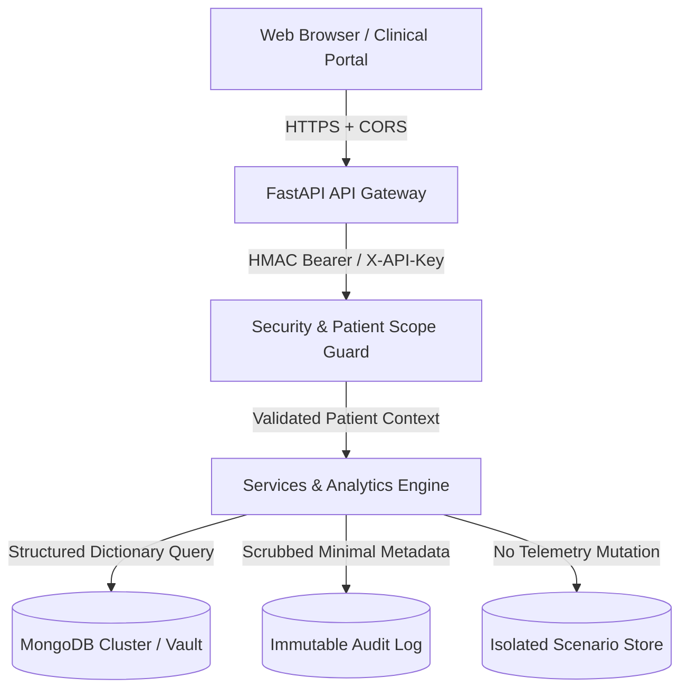

# SwasthyaTwin Security & Privacy Architecture

**Document Version**: 1.0.0  
**Status**: Formal Architectural Standard  
**Last Updated**: October 23, 2026  

---

## 1. Threat Model & Security Posture

SwasthyaTwin handles physiological telemetry, biometric baselines, and counterfactual lifestyle scenarios. As a personalized healthcare digital twin platform, it operates under the principle of **Defense-in-Depth** and **Zero Trust**.



---

## 2. Secrets & Credential Management

1. **Zero Secret Footprint in Source Control**:
   - Environment variables dictate all credentials (`MONGODB_URI`, `API_SECRET_KEY`, `APP_ENV`).
   - `.gitignore` explicitly blocks all `.env`, `.env.*`, `*.pem`, `*.key`, and credential files.
   - Audited git history confirms zero committed credentials.
2. **Log Sanitization & URI Masking**:
   - The database manager implements `sanitized_mongo_uri`, automatically redacting username and password credentials:
     ```python
     re.sub(r'://([^:]+):([^@]+)@', r'://\1:****@', uri)
     ```
   - Connection strings printed during startup or error reporting never disclose raw credentials.

---

## 3. Authentication & Authorization Framework

SwasthyaTwin defines two operational tiers:

### A. Demonstration / Hackathon Research Mode (`DEMO_MODE=True`, `API_SECRET_KEY=None`)
- Designed for local exploratory testing and hackathon jury demonstrations.
- Emits synthetic demo cohort members (`PT-1001` through `PT-1005`) labeled explicitly with `demo_data=True` and `is_synthetic=True`.
- Assigns request actor identity `demo_researcher` with non-diagnostic demonstration privileges.

### B. Production & Authorized Deployment Mode (`API_SECRET_KEY` configured or `DEMO_MODE=False`)
- Managed via `backend/app/core/security.py`.
- **Header Authentication**: Requires `X-API-Key: <key>` or `Authorization: Bearer <key>`.
- **Timing-Attack Resistance**: Evaluated using constant-time digest verification:
  ```python
  if not hmac.compare_digest(provided_key, settings.API_SECRET_KEY):
      raise HTTPException(status_code=401, detail="Invalid authentication credentials.")
  ```
- **Fail-Closed Guarantee**: If deployed in non-demo mode without a configured `API_SECRET_KEY`, the application fails closed (500 Security Configuration Error) rather than defaulting to open access.

---

## 4. Patient Isolation & Multi-Tenant Data Boundaries

Cross-patient data leakage is strictly prevented at three separate layers:

1. **Repository Query Scoping**:
   - Every database query for observations, assessments, alerts, and simulations enforces a mandatory `{"patient_id": patient_id}` clause.
   - MongoDB indexes are compound-indexed with `patient_id` as the leading key (`{patient_id: 1, observed_at: -1}`).
2. **API Route Authorization**:
   - The `require_patient_access` dependency compares the authenticated actor's authorized scope against the path parameter `target_patient_id`.
   - Unauthorized attempts by patient actors to access or query foreign patient records are blocked with `403 Forbidden`.
3. **Simulation Workspace Isolation**:
   - Counterfactual scenarios run in `backend/app/services/simulation_service.py` write exclusively to `db.simulations`.
   - Under no circumstances does a simulation run alter, overwrite, or mutate `db.observations`.

---

## 5. Input Validation & Injection Hardening

1. **Pydantic Schema Validation**:
   - All inbound payloads are validated and bounded by Pydantic models with strict typing, ranges, and patterns:
     - `patient_id`: Alphanumeric, 2–64 characters.
     - `heart_rate`: 25.0 to 260.0 bpm.
     - `spo2`: 50.0 to 100.0%.
     - `daily_steps`: 0 to 100,000 steps.
     - Units strictly checked against `VALID_UNITS` dictionary.
2. **NoSQL & Regex Injection Defense**:
   - In `PatientRepository.list_patients`, user-provided search queries are sanitized using `re.escape`:
     ```python
     if search and search.strip():
         safe_search = re.escape(search.strip())
         query["$or"] = [
             {"patient_id": {"$regex": safe_search, "$options": "i"}},
             {"display_name": {"$regex": safe_search, "$options": "i"}}
         ]
     ```
   - This prevents malicious regex characters (e.g., `.*`, nested quantifiers) from triggering catastrophic backtracking (ReDoS) or unintended document disclosure.

---

## 6. Audit Trail & Logging Hygiene

1. **Forbidden Key Scrubbing**:
   - `AuditRepository` automatically intercepts all logged details and strips sensitive keys:
     ```python
     FORBIDDEN_AUDIT_KEYS = {
         "password", "secret", "uri", "token", "authorization", 
         "auth", "credentials", "apikey"
     }
     ```
2. **Health Record De-Identification**:
   - Audit events log operational metadata (e.g. `action="create"`, `resource_type="observation"`, `actor="api_client"`), but **never** record raw biometric values, clinician notes, or genomic information in audit logs.

---

## 7. Transport Security & Network Policies

1. **Cross-Origin Resource Sharing (CORS)**:
   - Configured through `settings.CORS_ORIGINS`.
   - By default, restricted to trusted frontend ports:
     `http://localhost:5173, http://localhost:3000, http://127.0.0.1:5173, http://127.0.0.1:3000`.
   - Wildcards (`*`) are disallowed for production origins when credentials are enabled.
2. **File Upload Security**:
   - Wearable CSV file imports are processed strictly in-memory using pandas/csv streams with line-count limits ($< 10,000$ rows) and strict column schema enforcement. Files are never executed or persisted directly to disk.

---

## 8. Privacy & Fictional Demonstration Cohorts

1. **Fictional Public Data**:
   - All pre-seeded profiles (`PT-1001` John Doe, `PT-1002` Jane Smith, `PT-1003` Robert Chen, `PT-1004` Sarah Patel, `PT-1005` Michael Brown) are completely fictitious synthetic personas.
   - Any live observation injection (`/api/v1/seed/inject-live-observation`) tags records as `is_live_demonstration=True`.
2. **Consent Confirmation**:
   - The patient onboarding model (`PatientCreate`) requires explicit `consent_confirmed: bool = True` acknowledging that health telemetry is monitored for research and wellness analytics.

---

## 9. Regulatory & Diagnostic Disclaimers

> [!IMPORTANT]
> **Not a Medical Device**: SwasthyaTwin is a prototype digital twin platform designed for biometric baseline tracking, preventive wellness analytics, and research explainability.
> - It is **not** cleared or approved by the US FDA, EMA, or CDSCO.
> - It does **not** provide clinical diagnosis, disease probability calculation, or automated prescription advice.
> - In any medical emergency, users must contact licensed medical professionals and emergency services immediately.
