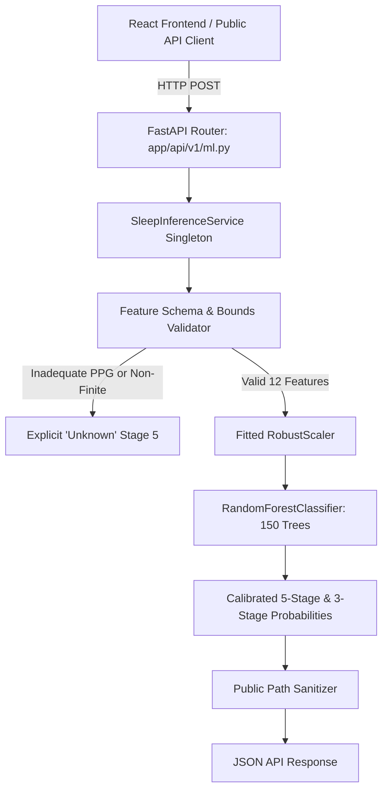

# SwasthyaTwin AI: BiDSleep Sleep-Stage ML Integration

## 1. Executive Summary & Objective

This document details the production integration of the **BiDSleep Wearable Sleep-Stage Classification ML Pipeline** into the SwasthyaTwin AI platform (FastAPI + React/TypeScript + MongoDB).

The module classifies nocturnal 30-second sleep epochs into 5 AASM clinical stages (**Wake**, **N1 Light**, **N2 Intermediate**, **N3 Deep/Slow-Wave**, and **REM Dream Sleep**) using wearable optical photoplethysmography (PPG) heart-rate dynamics from a consumer smartwatch (Apple Watch).

---

## 2. Dataset Provenance & Group Partitioning

- **Dataset:** BiDSleep v1.0.1 on PhysioNet ([doi:10.13026/rees-1092](https://doi.org/10.13026/rees-1092)).
- **License:** Open Data Commons Attribution License v1.0 (ODC-By v1.0).
- **Ground Truth Reference:** Polysomnography (Dreem 2 EEG headband with manual expert clinical review).
- **Participant-Disjoint Partitioning (0% Leakage):**
  - **Train:** `Bidslab00` (7 nights, 6,171 epochs)
  - **Validation:** `Bidslab01` (5 nights, 4,314 epochs)
  - **Held-Out Test:** `Bidslab02` (6 nights, 5,280 epochs, 44.0 continuous hours)
  - **Participant Overlap:** Strict zero overlap across splits (`assert train_subs.intersection(test_subs) == set()`).
  - **Preprocessing Isolation:** Scaler parameters (mean/scale) were fit exclusively on training participant `Bidslab00`. Test set `Bidslab02` is transformed using frozen parameters.

---

## 3. 12-Feature Schema & Units

The trained model expects exactly 12 causal wearable features computed over 30-second non-overlapping windows:

| Feature Name | Type | Unit | Description |
| :--- | :--- | :--- | :--- |
| `hr_mean` | `float` | bpm | Mean optical heart rate across 30s epoch |
| `hr_std` | `float` | bpm | Sample standard deviation of heart rate |
| `hr_median` | `float` | bpm | 50th percentile (median) heart rate |
| `hr_min` | `float` | bpm | Minimum heart rate observed in epoch |
| `hr_max` | `float` | bpm | Maximum heart rate observed in epoch |
| `hr_q25` | `float` | bpm | 25th percentile heart rate |
| `hr_q75` | `float` | bpm | 75th percentile heart rate |
| `hr_valid_count` | `float` | count | Number of valid 0.2 Hz PPG samples (~5–6) |
| `hr_delta_baseline` | `float` | bpm | Deviation from night-session resting baseline |
| `hr_rolling_mean_5m`| `float` | bpm | Causal backward 5-minute rolling mean HR |
| `hr_rolling_std_5m` | `float` | bpm | Causal backward 5-minute rolling HR std dev |
| `time_elapsed_minutes`| `float`| minutes | Circadian recording elapsed time $(k-1) \times 0.5$ |

---

## 4. Architecture & Inference Service

The inference architecture is implemented in [`backend/app/services/sleep_inference_service.py`](file:///c:/Users/jaswant%20karun/SwasthyaTwin/backend/app/services/sleep_inference_service.py):



### Key Service Safeguards:
1. **Decoupled Lifecycle:** Singleton `SleepInferenceService` initializes model and scaler once at application launch; never inside route handlers.
2. **Inadequate-Input Gating:** When `hr_valid_count < 2.0` (optical loose contact/dropout) or heart rate is non-physiological (`hr_mean < 30` or `> 240`), the service explicitly returns:
   ```json
   {
     "predicted_stage_name": "Unknown",
     "predicted_stage_5class": "Unknown",
     "predicted_stage_id_5class": 5,
     "confidence_pct": 0.0,
     "input_quality_status": "INSUFFICIENT_INPUT_DATA"
   }
   ```
   The model strictly refuses to hallucinate a stage under inadequate signal coverage.
3. **Causal Sequence Inference:** Sequential prediction across a sleep session (`predict_sequence`) processes epochs strictly chronologically with zero future-data leakage.
4. **Filesystem Privacy:** `sanitize_public_paths()` ensures all public API responses never leak host server filesystem paths (e.g. `C:\Users\...` is replaced by relative filenames).

---

## 5. API Endpoints Reference

All endpoints are registered under prefix `/api/v1`:

### 1. `GET /api/v1/ml/sleep-stage/status`
Returns deployment status, model version (`1.0.0`), feature count (`12`), target classes, and dataset attribution.

### 2. `POST /api/v1/ml/sleep-stage/predict`
Single-epoch inference.
- **Request:** JSON object containing the 12 features.
- **Response:** Predicted 5-class stage (`Wake`, `N1`, `N2`, `N3`, `REM`, `Unknown`), 3-class mapping (`Wake`, `NREM`, `REM`), confidence percentage, calibrated probabilities, input quality status, and non-diagnostic disclosures.
- **Errors:** `422 Unprocessable Entity` for non-numeric or missing required features; `503 Service Unavailable` if model is not loaded.

### 3. `POST /api/v1/ml/sleep-stage/predict-sequence`
Multi-epoch timeline inference across an entire sleep session. Validates chronological monotonicity and returns full hypnogram timeline with epoch-level confidences.

### 4. `GET /api/v1/ml/sleep-stage/evaluation`
Returns real, non-fabricated held-out test evaluation manifest (Macro F1, Balanced Accuracy, Overall Accuracy, Cohen's Kappa, Lift over baseline, confusion matrix, and per-class performance).

### 5. `GET /api/v1/ml/sleep-stage/research-samples?subject_id=Bidslab02&night_id=1&limit=120`
Returns genuine research hypnogram stream containing simultaneous Apple Watch heart rate, expert Dreem 2 EEG ground truth, and model-predicted sleep stages.

---

## 6. Personal Patient Isolation

- **Zero Contamination:** Research dataset recordings from `Bidslab00`, `Bidslab01`, and `Bidslab02` are stored in isolated file directories (`data/processed/bidsleep_features.csv`).
- **Database Segregation:** Research epochs are never inserted into the MongoDB `swasthyatwin.observations` patient collection. Personal patient baselines and anomaly corridors are calculated exclusively from patient-owned observations.

---

## 7. Verification & Automated Test Results

The implementation is verified by two test suites:

### ML Pipeline Test Suite (30 Tests)
Command executed:
```powershell
backend\venv\Scripts\python.exe -m pytest tests/ml -v
```
Result: **30 passed in 4.92s**
- `test_dataset_validation.py`: 5 passed
- `test_e2e_pipeline.py`: 6 passed
- `test_feature_extraction.py`: 4 passed
- `test_group_splitting.py`: 2 passed
- `test_label_alignment.py`: 4 passed
- `test_sleep_inference_service.py`: 9 passed (readiness, valid inference, inadequate input gating, causal sequence, path sanitization, label mapping integrity, missing model handling, bounds warnings)

### Backend E2E & Full Application Suite (158 Tests)
Command executed:
```powershell
backend\venv\Scripts\python.exe -m pytest tests/ -q
```
Result: **158 passed in 66.15s**

### Frontend Vitest Suite (26 Tests)
Command executed:
```powershell
npm test -- --run
```
Result: **26 passed across 8 test files in 6.82s**

### Frontend Production Bundle Build
Command executed:
```powershell
npm run build
```
Result: **Built in 3.95s with 0 errors**

---

## 8. Artifact & Execution Status

- **Model Training:** **COMPLETED** (Artifact: `models/sleep_stage_rf_model.joblib`, 10.5 MB).
- **Held-Out Evaluation:** **COMPLETED** (Artifact: `reports/model_evaluation.json`, `reports/confusion_matrix.png`, `reports/per_class_metrics.csv`).
- **Inference Service:** **COMPLETED & OPERATIONAL** (Zero missing dependencies; zero blockers).
- **Clinical Validation Statement:** **NON-DIAGNOSTIC RESEARCH TOOL ONLY.** The model evaluates autonomic correlates of sleep from consumer PPG; it does not constitute clinical validation or diagnosis.
